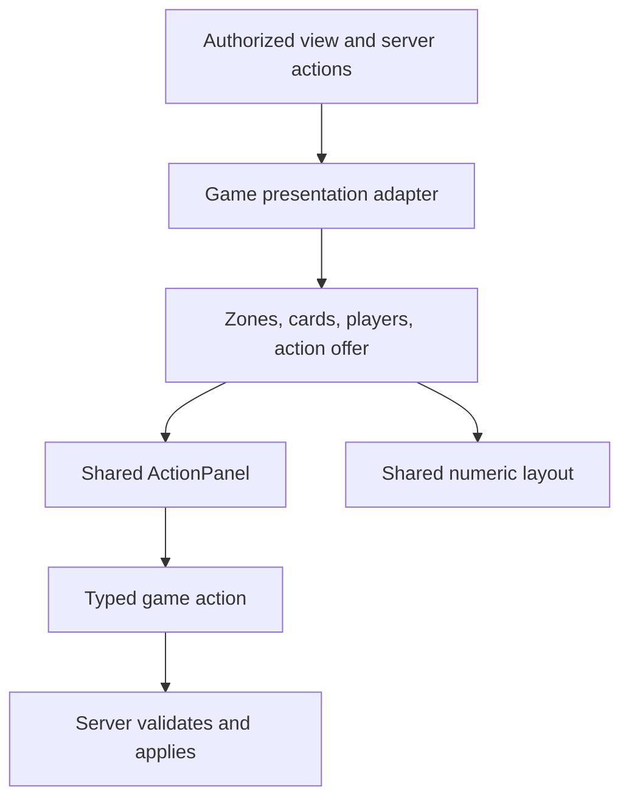
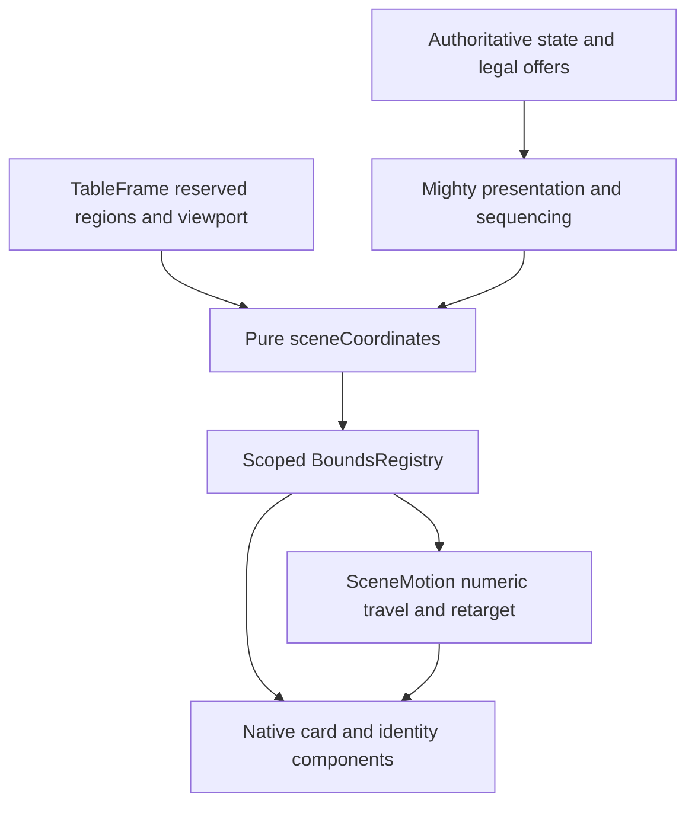

# Architecture

## Shared room and game layers

The existing Rust `Game`/`Table`/`HandReport` contracts and typed `Room<G>`
remain the game-independent engine and room authority. Frontend `Room` owns
one `TableSession<G>` and passes it through `TableProps` to the game renderer.
The framework-independent `room/sessionCore.ts` owns seat admission, identity
acknowledgment, reservations, preview/cancel, observer orientation, seat commands,
readiness and shuffle. `TableSession.svelte.ts` supplies reactive state and
synchronizes authoritative room/client changes; it does not repeat those decisions.
`SeatMenuHost` and the participation/people sheets use that same owner.

Mighty no longer chooses join versus reservation versus offered-seat acceptance,
opens the room's seat commands, or owns observer draft names. It supplies its
card state, rules, results, identities and DOM anchors. It reports any remaining
hand animation to the session; once the room is between hands and animation
has finished, the own identity returns to the centered dock. Explicitly
standing retains the current bottom seat rather than restoring an old viewpoint.

The controller is tested with unrelated three-seat game payloads, alongside
actual Mighty admission, swap-to-empty, bot configuration, stand/rejoin and
completed-hand flows. This proves the common lifecycle contract independently
of Mighty; a second complete game renderer has not been added. Games provide their card content, actions and results through the registry;
shared numeric layout and identity movement are supplied by `lib/table`.

## Frontend game presentation contract

Compiled games now register a pure `GamePresenter<StateMsgOf<G>, G['action']>`
as `RoomGame.present`. `Room` passes it to the game table; standalone previews
use the same game's adapter as their fallback. The contract lives in
`web/src/lib/table/presentation.ts`, not in Svelte or a server wire schema.

| Contract | Responsibility |
| --- | --- |
| `GamePresentation<A>` | Semantic zones, visible card descriptors, player identities/counters, status and current action offer |
| `ActionOffer<A>` | Revision identity that changes when the viewer, availability, payload or parameters change |
| Command action | Exact typed payload supplied by the game adapter |
| Number action | Supplied min/max/step/initial/input label and a pure typed payload factory |
| `validateAction` | Validate current offer identity, unique action identity, enabled state and finite/range/step constraints without invoking a factory |
| `resolveAction` | Validate at submission and create the typed payload exactly once |

Actions select primary, secondary, quiet or danger intent. `ActionPanel.svelte`
uses the existing Button/Chip primitives and global input styles; games do not
supply button CSS through the contract. Numeric drafts and keyed gesture targets
reset when the offer changes, and submission checks the current offer again.
The scoped AST policy covers the new panel/demo surfaces; it does not claim that
all legacy Mighty controls already satisfy the design-system migration.

Mighty's registered adapter uses the authorized view and exact legal payloads,
never local suit/scoring rules. The live server offer gates displayed cards,
including discard membership; its distinct joker actions feed the shared panel.
Viewer mismatches omit both private cards and private action payloads. Displayed
hand animation may lag live state; availability and offer revision come from
live state so stale animated turns cannot submit old card choices.

`table/examples/poker.ts` is only a projection fixture: supplied chip counts,
community/hole cards, fold/call and bounded raise options. It hides private faces
and actions from observers, but contains no poker rules, playable room or money
handling. `/preview?contract=1` compares both adapters with the same control
renderer and records local demonstration payloads without sending game actions.

The shared DOM card renderer now lives in `ui/cards/PlayingCard.svelte`, with
one owner for the card frame, face/back artwork, highlighting, pointer feedback
and accessible markup. `games/mighty/Card.svelte` is a thin game adapter that maps
its seal to generic emphasis and preserves its existing labels and props.
Settings and deck previews use the shared back artwork directly; old copies of
the back/court/cue components are removed.

`CardSpec.visual` can describe a standard face or joker through pure common
`cardTypes.ts` types. `table/cardVisual.ts` converts supported descriptors without
parsing opaque asset keys. `ui/cards/CardView.svelte` consumes these normalized
cards: face-down returns before reading private face metadata and renders only
a back labelled `비공개 카드`. Unknown face-up artwork stays a labelled fallback;
custom game artwork is not automatically converted to a standard deck. The
contract demo uses this same renderer for its Mighty and poker cards. `CardView`
is a read-only image surface; action availability/refusal remains with the shared
action panel or interactive game card adapter. An unavailable public table card
is not automatically dimmed by this static renderer.

Mighty bidding and exchange confirmations now use shared `CommandButton`
controls. Game panels compose the choices, while the shared layer owns command
intent, disabled state and current-offer validation. An observed offer transition
invalidates retained DOM targets, including a revision that later returns to the
same identifier. Numeric actions invoke their payload factory only on a valid
current submission.

Discard preparation validates the whole selection against one offer before
sending any card. The server still receives individual discard commands; this
is not an atomic backend transaction. Shared card selection can remain stationary
inside a picker, while the hand retains its raised-card feedback.

The DOM coordinate engine below owns live geometry and motion. Games remain
compiled adapters; no dynamic game loader is introduced by this contract.

## DOM coordinate engine

The live renderer uses the original Svelte DOM and SVG components. The Canvas
paint adapter and its DOM-reading geometry/mirror machinery have been retired;
historical evidence remains in CANVAS_PARITY.md. Existing Canvas preview URLs
open the DOM engine preview for bookmark compatibility.

`frameLayout.ts` owns numeric playing-screen regions: status, narration,
arena, decisions, hand dock, sidebar, tools, result and participation. `TableFrame`
applies its resolved rectangles; CSS no longer chooses the outer grid or moves
those regions at game-specific breakpoints. `dockLayout.ts` owns the hand slot
inside the dock, and arena overlays use the same numeric ring as players.

One frame-local `MeasurementScheduler` batches region and intrinsic-content
reads before publishing any changes. It caches the root rectangle once per
batch, coalesces resize/font notifications, skips unchanged values and cancels
pending work on disposal. Native text/identity/hand dimensions are inputs;
rendered card rectangles are not layout authority.
`sceneCoordinates.ts` delegates numeric seat, hand and dock geometry to the shared
layout functions and publishes all bounds in one TableFrame-local space. Hidden
card face metadata never enters this geometry layer. Scoped registry cleanup
cannot erase a card identity already transferred to another zone.

Mighty Felt, Hand and Tray consume these numeric results. Hand cards use keyed
absolute SceneNode containers; selection/deal/kitty styling remains on their
native inner components. Opponent identities are keyed by participant identity.
The unconditional local Seat host persists through waiting, play and result.

`SceneMotion` consumes explicit source/target bounds for arrival and collection.
Retargeting samples the current native transform and opacity, then rebases that
pose against the new numeric box; it never measures a card's DOM rectangle.
The registry stores resting layout bounds. `sampleVisualBounds` projects those
known corners through current native transforms and CSS translations when a
card travels or a player receives a trick. This includes an interrupted hand
reorder and raised, picked, hover or leading-card decoration without making DOM
rectangles the layout authority. Unsupported ancestor projections fall back to
the registered box rather than guessing a new layout.
Mighty Animator retains the original queue, delays, winner hold and score order.
Native buttons retain focus, accessibility, keyboard handlers and current-offer
validation. Menus, forms and reports continue using ordinary shared UI layout.

## Shared HUD layout and measurements

`hudLayout.ts` resolves status flow, stacked sidebar panels, scoreboard columns,
result summary and action-row policy. `HudFlow`, `HudRows`, `HudResult` and
`HudActions` measure their native leaves through the same frame scheduler and
apply the numeric boxes. Games supply labels, authorized values, badges and
callbacks, not a second set of responsive positions. Stable attachment identities
and equality checks prevent measurement/subscription churn. Unmeasured content
is hidden until a real region is available, rather than painted at zero-width
placeholder coordinates.

Intrinsic text wrapping and artwork remain browser responsibilities; numeric
ownership does not mean implementing font shaping. Card fans/seat layouts retain
their specialized algorithms. WASM was tested in isolated experiments but is not
an application dependency: the same-structure kernel was not faster, and the
larger solver prototype demonstrated feasibility rather than a product speedup.

The DOM renderer keeps individual HTML elements grouped in components. Containers
establish coordinate spaces; they do not choose a competing CSS layout. Shared
numeric policies now resolve playing-screen identity children, decision controls,
feedback, scoreboard and status contents, result stacks, participation/lobby
controls, round-history columns and misdeal/lead overlays. `EngineFlow`/`EngineRow`
measure intrinsic native leaves and calculate row/stack/wrap/fill rectangles;
`DecisionRegion` applies numeric allocations to the existing native controls.
`seatIdentityLayout.ts` resolves figure, metadata, name, status, thinking,
feedback and empty-seat action bounds. Local figures/names retain readable
48px/16px phone/tablet and 40px/14px short-landscape policies.

The browser still shapes text and paints native controls, SVG/card artwork and
decorative effects. Those intrinsic sizes are layout inputs. App chrome and
safe-area lengths are measured inputs to frame height, including CSS calculated
lengths. Ordinary app navigation, settings, people/seat menus, share dialogs and
replay modals are separate document surfaces; their shell layouts are outside
the live playing-screen geometry domain. The friend-picker's game controls and
round-history contents use the same numeric owners even inside such a shell.

Decision controls separate natural width from allocated height. Batched, cached
hidden native probes retain the real CSS/font ancestry; explicit card/form and
group dimensions bypass probes. Fractional widths round upward. Viewport, font
revision and content/style changes invalidate the cache, so narrow allocations
cannot poison later wide layouts. Probes are inert, hidden and removed before
publication; original controls retain their handlers and focus.

## Shared table geometry

`web/src/lib/table/frameLayout.ts` is the canonical owner of viewport budgets
and region geometry, rendered by `ui/TableFrame.svelte`. Neither imports game
rules or room protocol. Games supply content and generic controls/completion
flags; these may move overlays but never resize the arena or opponent bands.
Decision overlays and observer content have bounded regions inside the same
frame, rather than increasing the room page's height.

Mighty retains its rules, card rendering, seat-to-view mapping, role badges,
trick display and action panels. Its `Table.svelte` no longer owns grid tracks
or a measured decision-height reservation. `table/layout.ts` selects compact
geometry from viewport space only; `Felt.svelte` measures its region and renders
the resulting numeric anchors; preparing, playing and revealing a role
do not move opponent anchors. Explicit seating/shuffling is the separate
identity movement, and the own-character slide runs into the card-side dock for play and back
to the center when the hand finishes.

The dock uses the same `Seat` component before and during play on every
viewport; the separate mobile name/role renderer is removed. Automatic cue,
collection, friend-reveal and whole-table transforms no longer jostle player
identities. Cards, reaction bubbles, badges, turn highlighting and eye
movement retain their own feedback. Decision captions stay above the dock's
identity region instead of painting over the local player's role/name.

After completion the arena shows five player rows with one column per played
round using `FinishedHands.svelte`, shared with the details sheet. Cards stay
in trick order rather than suit order; each column marks its winner. The continuation remains
below those hands; there is no alternate empty-table/folded result view.
`더보기` groups single-round replay, the full round matrix and score/exchange
details. It retains
immutable recorded names/rules when the live room advances, and discard privacy
still follows the recorded rules. Small screens scroll only the bounded hand
region instead of growing the page.

The frontend core separates numeric table/hand layout, identity movement, and
room participation from Svelte. The layout has viewport/region inputs, never
turn or Mighty phase inputs. The browser adapter measures elements and plays
core-produced translations; interrupted updates invalidate queued playback and
hidden tabs cannot keep a movement pending indefinitely. Svelte owns accessible
DOM content, controls and lifecycle; CSS keeps appearance and native text/art
rendering. Shared numeric policy owns playing-screen placement.
The Rust rules and server authority remain unchanged. A layout demo is not a
second rules implementation or evidence that every poker session feature exists.

The proving presets currently cover three, five and six seats. Five-seat bands
preserve the existing production proportions; the three/six-seat demo reserves
a 56px identity footprint. These are explicit layout profiles, not a claim that
arbitrary renderer dimensions or arbitrary seat counts are already supported.
The browser demo at `/preview?layout=3` or `6` uses no Mighty payload/components
and checks scene continuity, resize, card/identity separation and viewport bounds.
`table/handLayout.ts` owns responsive card sizing, overlap and row ranges;
`Hand.svelte` supplies actual cards and their rule-specific actions.
Visual review compares waiting/play/result captures at desktop, tablet and two
phone sizes, with actual opening and completed-hand motion videos. Fixture
results contain partial hands; a real completed hand is the 50-card/10-winner
receipt. Artifacts remain outside the repository.

The proving gate is an actual shuffled start through bidding, exchange and
play: opponent character bounds remain within 1px, controls clear identities,
and the page stays within its viewport. Separate tests cover direct name
entry, rename/reclaim identity, and full-hand continuation. Preparation
indicators below characters are removed; multiplayer readiness remains.

Current boundaries after cleanup Phase 7 (`4c4b8aa`, 2026-10-06) and the
local continuous-table implementation (2026-10-07).
[PLAN.md](PLAN.md) owns direction; this file owns implementation structure.

## One hand and one room

A game is a deterministic state machine. Chance is drawn outside it and
applied as an explicit action. Seat actions are checked by
`legal_actions(state, seat)` and applied with that seat; legality can exist
off turn (immediate 딜미스). `turn` says whom the driver waits for and when
chance is needed, not who is allowed to act.

A room owns seating, connections, pacing, a session of hands, scores,
persistence and broadcasts. It runs a game through table traits. Clients and
bots see the authorized view, not the full state. Replay uses versioned actions.

## Rust ownership

| Crate | Owns | Boundary |
| --- | --- | --- |
| [engine](../crates/engine) | Game, Bot, GameInfo, Table, HandReport, TableBots, Level | Core, rule metadata and table hooks; no model runtime |
| [engine-ml](../crates/engine-ml) | Encode, Spec, Observation, Belief, ActionValues | Model features/outputs; hidden targets separate from inputs |
| [mighty](../crates/mighty) | Rules, presets, state, actions, views, table hooks, encoding | Canonical Mighty legality/scoring; [RULES.md](../crates/mighty/RULES.md) describes it |
| [mighty-ai](../crates/mighty-ai) | Simple/search/hybrid bots, reading, endgame and sampling | Shared PIMC core; table bots implement TableBots |
| [harness](../crates/harness) | Checked play, parallel games, timing/stats/provenance | Generic over Game |
| [sim](../crates/sim) | Typed bot specifications and Research hooks | Shared research interface; explicit Mighty registration/spec handling |
| [lab](../crates/lab) | Controlled replay/phase diagnostics | Mighty-specific experiments; binary lab |
| [env](../crates/env), [env-py](../crates/env-py) | Deterministic batches, arrays, self-play/Python interface | Research + Encode; Python dispatch registers game ids |
| [eval](../crates/eval) | Suites, paired comparisons, puzzles, reports | Research hooks; CLI registers the measured game |
| [infer](../crates/infer) | ONNX loading, parity and prediction | Implements model-output traits via tract |
| [server](../crates/server) | Rooms, transport, stats, persistence, game catalog/codegen | Shared rooms; compiled games registered by id |

Generic cores and explicit registration are different responsibilities.
A binary naming Mighty at registration is expected; a shared room deciding
Mighty's scoring is not. The early `engine::dynamic`, `JsonGame` and
`SessionGame` abstractions are no longer the architecture.

## Server flow

1. GameCatalog resolves the game id and parses its typed rules/settings.
2. A typed Room receives shared RoomEnv dependencies and that game's bots.
3. Room actor receives player/internal messages; settle advances the hand,
   arms deadlines, schedules thinking, persists and broadcasts.
4. Bot jobs carry authorized view/legal actions to the remote worker or
   local fallback. Worker protocol/build identity is reported by /version.
5. HandReport supplies summaries/notes/outcomes; session owns multi-hand totals.
6. Typed snapshots replay/restore through the game's registry entry.

The room module is split into actor, seating, session, lifecycle, hand, clock,
bots, snapshot and view. `lifecycle` owns observer identity, readiness,
next-hand admission, immutable public hand records and score epochs. The ordinary
flow is a continuous table: a finished hand leads to the next hand, without a
shared session-end/rematch ceremony. The Rust protocol is authoritative;
generated TypeScript and the protocol digest change together.

### Participation and authority

Observer credentials identify a visitor across connections; they do not
authorize a seat or private cards. Private guest credentials and their links to
seat tokens stay in the snapshot and are removed from problem reports. Public
`participant_ids` identify current seat occupants. Public `participation` rows
contain FIFO order, visitor ID/name, reserved coordinate, frozen target ID and
consenting outgoing ID; they never contain credentials.

`RequestSeat` joins or cancels the ordered queue, optionally choosing a bot or
empty seat. Available seats are reserved in queue order. At a full human table,
a seated human uses `OfferSeat` to offer only their own seat to the oldest
unassigned request; withdrawing revokes only that person's offer. `AcceptSeat`
is the incoming observer's explicit between-hand confirmation. The actor checks
the connection's identity, reservation, coordinate and current target identity
before the atomic handoff. The outgoing human becomes an observer. A reservation
cannot itself reveal cards, and a direct newcomer Join is refused during play.
Seat mutations revoke stale target consent. A reserved admission blocks Start
until acceptance or cancellation; an unassigned waiting request does not.

Connections sharing one visitor are deduplicated. The last observer connection's
disconnect cancels the request, while another connected copy keeps it. A deliberate
Start prepares the single connected human when all other seats are bots. Multiple
humans each prepare explicitly; any seated participant may then start.

### Scores, current replay and persistence

`ResetScores` is a seated, between-hand action. It archives prior epoch records,
summaries and participant totals, including departed people; increments the score
epoch; clears readiness and all cumulative scores; and keeps people, seats and
rules. The just-finished hand and its booked flag stay on the table. Old data is
retained for compatibility, without an old-game browser in the ordinary UI.
Legacy EndSession/Rematch messages remain accepted by the protocol, but the new
UI does not expose the ceremony.

`SessionMsg.current_hand` contains the finished hand's frozen public view, rules,
names, IDs and payoffs. It survives score reset and changes in current occupants;
it clears at the next Start. Comparing its IDs with current `participant_ids`
prevents a newcomer inheriting the previous occupant's result. Reconstruction
also persists the hand's original settings, prior summary and opener rotation,
so a score reset or later rule edit cannot change how its saved log replays.
The booked flag prevents restoring or resetting a finished hand from adding its
payoffs or completion statistics again.

Snapshot V2 defaults missing lifecycle/reconstruction fields, preserving old
scores and summaries. Restore clears unconfirmed admission requests and readiness;
legacy ended snapshots become continuous tables without automatically resetting
scores. Old summaries without a saved public hand view remain summaries, not
invented replays. Persistence/stats writers keep disk work out of the actor's
main decision path.

Game routes are `/api/games/{game}/...`; older routes alias the default game.
A saved room records its game. This is compiled registration, not a runtime
extension loader. [game.rs](../crates/server/src/game.rs) is the registry seam.

## Browser ownership

| Layer | Owns |
| --- | --- |
| [room/](../web/src/lib/room) | Connection, room lifecycle, seats, menu/lobby, notices and shared controls; generic client types |
| [games/registry.ts](../web/src/lib/games/registry.ts) | Game id to table, rules sheet, labels, rulebook and tools |
| [games/mighty/](../web/src/lib/games/mighty) | Mighty table, phases, card art, rules UI, replay and preview |
| [table/view.ts](../web/src/lib/games/mighty/table/view.ts) | Pure display state from the authorized view |
| [table/animator.svelte.ts](../web/src/lib/games/mighty/table/animator.svelte.ts) | Shown state, queued movement and local cues |
| [generated/](../web/src/lib/generated) | Server-derived protocol and catalogs |
| [ui/](../web/src/lib/ui) | Shared presentation primitives; [design contract](DESIGN.md) |

Server-generated data owns payoff breakdown, card refusals, proposed contracts,
pinned rules and catalog facts. Browser modules format/draw them; they should
not independently reimplement those domain decisions. CI rejects stale
generated files.

Remaining coupling: Mighty page titles/sitemap, stats preset titles,
rulebook/editor pages, practice preference keys and concrete codegen types.
The registry currently contains one game; a second game has not validated
every proposed boundary.

## Research and artifacts

Python `ml/` owns typed configs, data readers, models, training, export and
the experiment runner. Rust owns game transitions/encodings. Parity fixtures
cross the Python/environment and PyTorch/ONNX boundaries.

A model reads one versioned encoding. Current Mighty is `mighty-4`; historical
models/data record older versions. Do not silently load or convert incompatible
weights. Reproduce historical experiments at their recorded revision.

Large shards/models/raw synthetic evaluation results live outside git with
committed checksums. The public repository contains configs, manifests and
bounded reports, not secrets or real player logs. [Research index](../research).

## Adding a game

1. **Rules:** implement Game and GameInfo, then Table/HandReport for settings,
   catalog, hand options, pacing metadata, summaries and notes. Add invariants,
   deterministic replay and hidden-information tests.
2. **Bots:** implement Bot and TableBots in the game's bot crate. Keep difficulty
   policy and off-turn choices game-owned.
3. **Research:** implement sim::Research; add Encode if models are required,
   pin its spec and parity, then register Python dispatch and an eval suite.
4. **Server:** register Game + GameBots in GameCatalog::standard and visit its
   types in codegen. Add concrete protocol/client type handling; test save,
   restore, worker and game-scoped routes.
5. **Web:** create games/<id>/ with a GameEntry, GameTypes and pure `present`
   adapter, register it,
   supply its table/rules/labels/tools. Resolve shared site assumptions as
   encountered; verify friends, bots, watchers and reconnects.

A poker implementation should expose gaps before adding further speculative
traits. Limit/no-limit Texas hold'em is the agreed scope; no poker behavior
is implemented yet.
