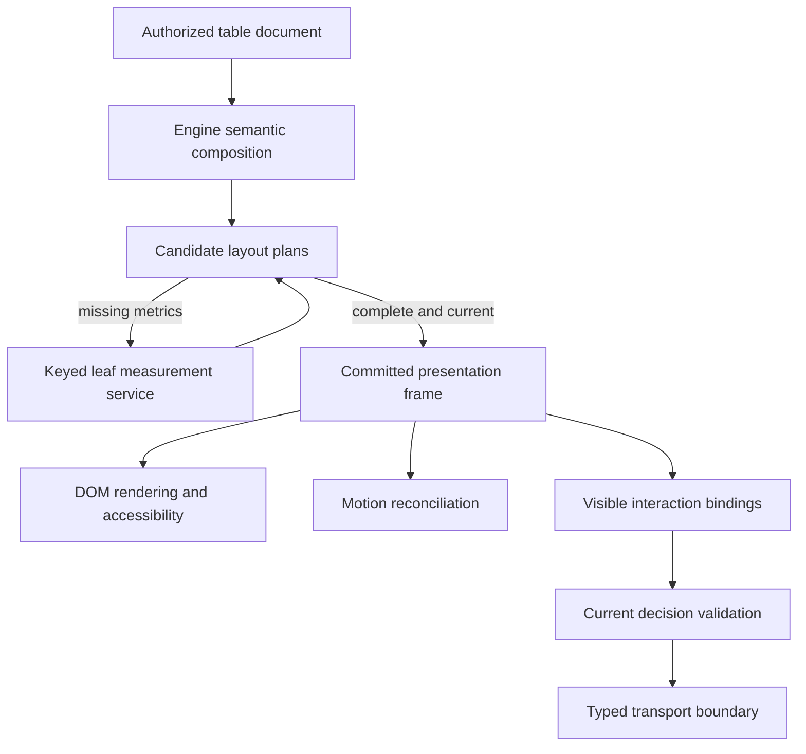

# Card game engine foundation

## Current acceptance status — 2026-10-19

Engine/UI acceptance is **open and failing**, under the active repair/strict-QA loop. The technical completion receipts below are historical; they do not approve the rejected foundation appearance, clear the651-case UI campaign or authorize new UI. [DESIGN.md](DESIGN.md#engine-migration-preserve-the-approved-ui) owns original Mighty appearance and navigation. The current repair separates selected visible collections from canonical public motion resources, preserves terminal public read timing, and restores the compact result/current-hand-only replay. Native verification remains required.

Status: implemented, locally qualified and delivered for the documented bounded v1 scope, October18,2026. Ordinary Mighty/Poker room routes now mount the shared engine; explicit `foundation=0` retains the original root for comparison. The completion goal is fulfilled through frozen technical qualification, independent final review and actual local delivery; see [the final report](ENGINE_RELEASE_REPORT.md). This document defines the current architecture and ownership contract, superseding the structural proposals in [Engine UI API](ENGINE_UI_API.md) and [Engine API contracts](ENGINE_API_CONTRACTS.md). Their exact-action, privacy and authoritative-server requirements remain applicable.

Real Mighty and a Poker vertical slice share one connected host, canonical session, measured numeric composition, DOM renderer and essential motion coordinator. Scoped Room/Game admission, correlated outcomes, uncertain-operation recovery, native forms/dialogs, asynchronous rulebook/history/device operations and bounded feedback are implemented. Current source passes 2,575 frontend tests, clean checking and production build; immutable backend qualification passes 257 server and 17 Poker tests plus strict Clippy/build. The complete45-file functional inventory passes206 cases/0 failures with56 deliberate profile skips; all three quiet numeric timing repetitions and cold/max-domain cases pass. [Completion gates](ENGINE_COMPLETION.md) and [the evidence inventory](ENGINE_COMPLETION_AUDIT.md) distinguish current evidence from historical checkpoints. The [wire contract](ENGINE_COMMAND_PROTOCOL.md) describes synchronization; the [implementation record](../web/src/lib/table/foundation/README.md) preserves earlier results and limitations.

The selected production candidate is a semantic card-table interpreter, not an ECS world or a React component API. Games project immutable meaning and exact actions; they do not register position-writing components or provide arbitrary layout trees. Internally the engine uses pure planning plus explicit session/runtime state machines. Svelte renders shared artwork at the DOM boundary; changing Svelte is not an engine requirement. Centralization means one owner for each authority and resource, not one singleton or one file.

Numeric, Yoga WASM and native composition comparison adapters share the same measured policy. Numeric is selected by current frozen-v12 repetitions: resize p95 7.705/7.754/7.867ms against8ms, with semantic families, resource and cold/max-domain gates passing. Yoga/native remain comparison adapters. Full functional/native Mighty/interruption evidence and bounded cross-game slices pass; independent final review and local delivery pass. Physical-device/AT/OS-IME/audible-hardware/GPU/whole-heap claims remain outside recorded coverage.

## Executable API and synchronization boundary

Game authors implement `ConnectedGameAdapter`: a pure `project` supplies an authorized `TableDocument`, `viewerMatches` identifies the permitted viewer, and `submit` converts one already-admitted semantic candidate through a single-use Game/Room submission capability. Optional form, outcome, assistance and read-policy hooks supply meaning through their declared boundaries. They do not construct `RoomClient`, a second runtime, coordinates or responsive CSS. `ConnectedRoom` is the shared mounted host for these adapters. Custom engine embedders use the public `createCardSession` and `createCardTable` factories; the public factory does not accept a planner override.

| Current executable owner | Responsibility |
| --- | --- |
| Server room actor, game implementation and checkpoint | Authoritative rules, hidden state, RNG, expected-version admission and duplicate/recovery receipts. Commit precedes durable publication. |
| `RoomClient` and `commandTransport` | Authentication, coherent native Room/Session/State publication and per-tab payload-free unresolved-operation recovery. They do not calculate table geometry or recreate lost actions. |
| `CardSession` | Own immutable authorized documents, local command admission, form/read-policy boundaries and receipt-fed local operation views. Transmission uses its fixed host port. |
| `TableRuntime` | Own presentation drafts, measurement/planning attempts, committed frames, input captures, local dialogs and coordinated visual motion. |
| `DomSurface` | Render the committed frame and forward scoped native input/measurements. Native input controls retain their platform editing behavior. |
| `ConnectedRoom` | Own one mounted instance of each client/session/runtime bridge and fixed local side-effect owners. Game adapters receive narrow snapshots and capabilities, not this owner graph. |

Server and clients synchronize game facts and command outcomes, not DOM positions. Each client receives only its authorized game view, then computes geometry for its own viewport and accessibility settings. A visual animation never advances gameplay; reconnect restores authoritative state without replaying historical flights or resending actions. The client is not a lockstep simulation of server layout, and the document is not an ECS world or a React component tree.

The native Session source has an opaque client-owned token replaced on every Session packet, even same-count replacements. Current-game projection excludes historical arrays. Completion retention and bounded public-history capture use that token rather than nested framework proxy identity; new reads still require invocation-time native ownership and source checks. An explicitly detached, already-selected public history snapshot may survive same-actor reseating only after private state is scrubbed and a fixed native retention guard succeeds. It grants no new read or command authority.

## Decision

Build a card-table interpreter with one composition protocol and one presentation publication boundary. Games describe authorized game meaning. Engine components negotiate their complete footprints, compose them into a fitting layout, and publish geometry, content and interaction bindings together.

The public abstraction is a card-table document. The internal layout abstraction is a width-bound measured plan. The renderer consumes a committed presentation frame. These three objects keep game meaning, geometry negotiation and visible state separate without allowing them to disagree.

All production element placement remains engine-owned and numerically resolved. DOM/Svelte provides rendering, native control behavior and leaf measurement. Application components do not choose gaps, heights, responsive breakpoints, clipping or individual coordinates. A logical component tree is necessary for ownership and accessibility; it does not grant HTML wrappers an independent CSS layout authority.

Primary viewport reservations are engine invariants. A board child's measured minimum cannot silently become the parent's accepted allocation and move the playable hand or continuation below the reserved viewport. The composer must choose a supported bounded board/reflow recipe or report that it cannot fit; the internal layout/runtime checks enforce the declared primary regions against the environment. Large-text board scrolling is distinct from letting the whole root grow through the primary dock. Games may supply qualitative collection relevance (`primary` or `auxiliary`); they never choose the resulting size, spacing, breakpoint or clipping. Canonical collection identity/counts remain present when their paint becomes compact.

## Centralized authority is the first invariant

For each state transition or side effect, exactly one owner may authorize it. Delegated components calculate local results under bounded capabilities; they do not acquire competing authority. One giant function or a process-wide singleton is unnecessary. The requirement is a small owner graph whose boundaries can be enforced and tested.

| Decision or mutable resource | Sole authority | Delegates may do | Forbidden competing writer |
| --- | --- | --- | --- |
| Canonical authorized document and command admission/journal | CardSession | Project pure authorized meaning; deliver scoped receipt outcomes | Renderer-owned canonical documents or adapter-side transport |
| Presentation drafts, disclosure and focus intent | TableRuntime state machine | Emit frame-scoped typed intents; observe immutable snapshots | Game-local selection stores, a second TableUi store for migrated state, renderer-owned canonical drafts |
| Recipe and theme policy | Runtime-selected immutable engine policy revision | Read the selected policy and report requirements | Per-game gaps, breakpoint branches, measured-height corrections or root CSS overrides |
| Candidate geometry and overlap permissions | Runtime-owned composition/planning pass | Return local requirements/plans through assigned parent-child interfaces | Ancestor prediction of descendant dimensions, DOM-class role discovery, another layout effect writing positions |
| Committed content, geometry, styles and bindings | FramePublisher under the runtime's surface lease | Patch assigned leaves; return success/failure | Component effects publishing partial geometry or rebinding actions |
| Visual motion | Runtime-owned MotionCoordinator | Sample/apply registered tracks within authorized envelopes | Independently timed transforms or WAAPI tracks changing layout/hit semantics outside the coordinator |
| Native input and gesture routing | Runtime-owned InputRouter | Forward captured, scoped native events | Component shortcuts, per-button action callbacks or codec-side transport calls |
| Measurements and timed UI effects | Runtime-owned scoped host adapter | Read leaf metrics; register observers/deadlines; return keyed results | Nested fallback measurement schedulers, unregistered listeners/timers or autonomous controllers |
| Submission execution and unresolved receipts | CardSession admission, the fixed host submission port and RoomClient/commandTransport wire ledger | Adapter performs pure conversion through a single-use capability; runtime references admitted operation state | A second wire receipt history, direct renderer/client.act path or remount-triggered resend |

`RoomClient` and `commandTransport` own the authenticated stream, coherent native publication, wire operation ledger and payload-free per-tab recovery metadata. `CardSession` owns the admitted canonical document, exact semantic command admission and its bounded local operation journal. `TableRuntime` owns presentation drafts, disclosure/focus intent and frame-scoped input. These are separate lifetimes, not multiple authorities for the same wire receipts. A renderer detach does not close a host-owned connection or regenerate a command.

Raw packets and native receipts enter `RoomClient`/`commandTransport` first. The shared `ConnectedRoom` host supplies coherent authorized semantic publications to `CardSession` and maps native receipt outcomes back to the originating local operation. The renderer and runtime do not independently reduce raw wire receipts. Server checkpoint durability and authenticated deduplication remain protocol guarantees; a local journal entry does not manufacture either guarantee.

Submission has two explicit boundaries. After validating the visible binding, `CardSession` synchronously records an immutable operation scoped to its originating document/offer. The fixed connected host then validates current native authority and permits one adapter conversion through the appropriate Game/Room capability. Detach or revocation before admission rejects the intent. After native admission, detachment cannot erase its wire identity or recreate its payload. Recovery queries or cancels that original operation; it never resends a replacement action with new credentials or context. An uncertain outcome is never treated as rejection.

Private command payload retention is distinct from minimal receipt retention. Revocation redacts canonical private data and local submission payloads while authenticated native recovery may retain its payload-free reference. An account replacement cannot query an old actor's operation using new credentials. `CardSession.dispose()` retires its reader/document and local authority and returns its unresolved count; it does not own or close the native socket. The mounted host disposes its runtime and client resources at its own lifetime boundary. Reload recovery is supplied only by the bounded native transport metadata, not by reconstructing a disposed CardSession journal.

The foundation directory also contains named application host bridges (`ConnectedRoom`, the entry router and device preference persistence) and executable fixtures. They are not a pure standalone engine package. The architecture import gate protects every current core module by default, including disclosures, forms and waiting layout; it forbids core imports of concrete games, legacy geometry/controllers and these host/fixture modules. Host entry/adapter checks separately prohibit a second lifecycle or application-owned geometry for both Mighty and Poker.

### Scope and lifecycle

Exactly one runtime writer may hold a mounted table surface, and a runtime may have only one interactive surface attachment. `attach` acquires an exclusive engine-issued lease and mount generation. Duplicate attachment fails without disturbing the active lease; replacing a writer requires an explicit detach/transfer. Another table or browser tab may have its own runtime. Frontend ownership does not serialize actions across tabs; authoritative server arbitration remains necessary.

```text
create → detached
detached -- attach(surface) --> attached(new mount generation)
attached -- detach ---------> detached(invalidate mount generation)
detached/attached -- dispose -> disposed(terminal)
```

Creation starts no DOM listeners, probes or animation loop. Detach synchronously closes input, cancels the candidate and all mount-scoped effects, releases focus ownership and makes callbacks from that mount ineffective. Retained compatible drafts are runtime/session state, not detached DOM state. Reattach revalidates the session and prepares fresh presentation; it never enables controls from a stale retained frame. Dispose is terminal and releases runtime state and registrations, while session-owned unresolved operations remain owned by that session.

Disconnect suspends commands whose freshness cannot be established. Reconnect requires a fresh authoritative projection before those commands are enabled, and never automatically resends under a new operation identity. Scope replacement revokes incompatible private data, gestures, drafts and motion before resynchronization. Replay uses a distinct read-only context with no live-submit capability; live operation resolution remains session-owned. Mirrors can consume immutable committed frames through read-only ports, not a second writable mount. Read-only consumers are still audience-scoped and revocable; they cannot retain withdrawn private frames. Native editing or interactive replay requires its own explicit surface/context ownership.

### One mutation ingress and scoped effects

Transport updates, pointer/keyboard intents, native edit events, resize/font changes, measurement replies, preferences and timer completions enter the owning runtime's sequenced ingress. Internal feature reducers may handle separate intent types, but only that runtime publishes their resulting state. Ordinary reentrant updates queue behind the active transition/commit. They cannot recursively prepare or publish another frame. Revocation, detach and disposal close the input fence and invalidate the relevant scope immediately; the publisher aborts unsafe work and performs required redaction before any reopening.

Components receive a mount-scoped interface to report intents and register measurements, editing or motion, not a runtime constructor, session subscription, scheduler or transport executor. Every registration has an idempotent release handle; cancelling its owner scope also reclaims it. The injected clock and host event service are shared through that owner. Rules deadlines remain server facts; a local timer may affect presentation and submit eligibility only under the declared capability.

Plans, fragments, bindings, overlays and editable islands carry private owner identity and relevant mount, audience and dependency generations. Arrange, overlay admission, edit ingestion, activation and commit verify ownership/freshness. Cancellation alone is insufficient because already queued callbacks can still arrive. Cached compatible leaf metrics may be reusable; an arranged plan, writable surface handle or action binding cannot be reused across roots. Shared metric services have independently cancellable requests, bounded caches and audience-partitioned sensitive entries. Disposing one consumer must preserve other consumers and reveal no scoped content.

### Enforceable module and extension boundaries

The current game-facing boundary contains typed semantic documents and connected-adapter hooks; the public engine factory exports expose session/table creation and semantic contract types. Fixed shared artwork and adapter submission codecs are wired by their declared host boundaries rather than a public dynamic registration API. Plan issuance, recipe selection, mutable stores, commit, motion scheduling and action execution remain engine-internal. The host injects ports at root creation; descendants do not retain the original mutable TableClient or transport object.

Game presenters and codecs are pure functions over their arguments. Layout extensions receive immutable inputs and child-measurement interfaces, returning local plans; they receive no DOM root, controller, transport or scheduling authority. Renderer extensions receive engine-managed mount/update operations and assigned geometry. Extensions cannot register another root, bypass the publisher or inject arbitrary layout styles. Brand/private handles require runtime owner checks at boundaries; a TypeScript cast is not proof of authority.

Enforce these rules with package exports/import-boundary checks, compile-negative fixtures and runtime ownership/geometry assertions. Restrict application styles to the host's outer allocation; engine theme revisions own table metric styles. Detect renderer drift with independent DOM/ink/hit checks. These are architectural controls for trusted code, not a sandbox against malicious JavaScript or arbitrary browser extensions.

### Centralization acceptance gates

The isolated proof must include these negative cases before migration:

- Attach two writers; reject the second. Attach → detach → attach, then deliver old measurement/timer/animation/focus callbacks; none may affect the new mount.
- Attempt foreign-root plan, binding, editable-island and overlay use; reject it. Share a metric/session service between roots; disposing one preserves the other without scope leakage.
- Trigger update, activation, revocation and disposal from focus restoration or renderer callbacks during commit; no recursive patch or stale dispatch is possible.
- Detach immediately before/after submission admission; reject an unadmitted intent and retain the same admitted operation. Deliver receipts after every renderer detaches; only the session record advances. Lose acknowledgement, reconnect/enter replay, or replace the account; never infer rejection, emit a replacement operation or expose/retry an old actor's private command under new credentials. Use a controlled session-port fixture until backend receipt capability is implemented; that fixture is not durability proof.
- Repeatedly mount, unmount and replace scopes; owner/resource counts return to the declared baseline. Forbidden game imports and direct dispatch/layout-write fixtures must fail architecture checks.

The runtime inspector should show each node's owner/parent, chosen recipe, requirements/allocation, permitted paint/hit/overlay extents, active frame/binding generation, and mount-scoped resource counts. Diagnostics remain audience-scoped and avoid hidden payload dumps. A geometry fix without an identifiable owner and violated invariant is not an acceptable completion receipt.

## What the current design gets wrong

The recent border overlap was one instance of a structural failure: multiple modules independently predicted the same subtree's size. The latest correction makes the frame call identity geometry and add its difference to a dock baseline. That repairs the example while preserving the frame's knowledge of identity internals.

| Inspected source | Structural problem | Replacement responsibility |
| --- | --- | --- |
| [frameLayout.ts](../web/src/lib/table/frameLayout.ts), [dockLayout.ts](../web/src/lib/table/dockLayout.ts), [seatIdentityLayout.ts](../web/src/lib/table/seatIdentityLayout.ts) | Ancestors know descendant recipes and compensate for assumed dimensions | Frame measures Dock; Dock measures its children; each parent knows only returned requirements |
| [dockLayout.ts](../web/src/lib/table/dockLayout.ts) | An over-tall hand can be centered outside its reservation | Reject an insufficient allocation or select an explicit supported arrangement |
| [DecisionRegion.svelte](../web/src/lib/table/DecisionRegion.svelte) | DOM classes and mutations supply an implicit layout model | Engine composition supplies typed children before rendering |
| [measurementScheduler.ts](../web/src/lib/table/measurementScheduler.ts) | Subscriber values publish round by round; exhausted rounds reschedule | Isolated candidate preparation, keyed measurements, bounded failure and one frame commit |
| [frameMeasurements.ts](../web/src/lib/table/frameMeasurements.ts) | Initial readiness does not define later font/resize publication | Every candidate is checked against its complete environment and presentation dependencies |

Moving more formulas into a shared directory will not remove these ownership conflicts. A general solver also cannot repair them without a coherent contract around it.

## Authorities and the public API

| Owner | Supplies or decides |
| --- | --- |
| Rules authority | Hidden state, legality, game resources, actor/opportunity identity, response arbitration, settlement and authorized projections |
| Game presenter | Pure mapping from an already authorized view to participants, collections, labeled facts, decisions and optional authorized transitions |
| Engine composer and runtime | Presentation recipes, space allocation, adaptation, drafts, focus, input capture, clipping, motion and publication |
| Renderer and measurement service | Native leaf metrics and faithful rendering of committed geometry/content/styles; native editing/accessibility integration |

The frontend presenter must not receive full hidden state and then try to conceal it through layout. The transport remains a narrow host boundary. Frontend frame identities are not server authentication, durable receipts or legality checks.

The implemented adapter entry point is `ConnectedGameAdapter` in `connected.ts`, mounted by `ConnectedRoom.svelte`; `games/mighty/connected.ts` and `games/poker/connected.ts` are real consumers. Its `project` receives a detached authorized client snapshot and optional host-owned previous-publication evidence. Its `submit` receives separate single-use Game/Room capabilities. Projection cannot send commands; returning `true` from an adapter cannot invent transport admission.

For custom engine embedding, these are the current factory signatures exported by `foundation/index.ts`:

```ts
createCardSession<A>({
  transport: (submission: Submission<A>) => void,
  // Optional bounded form and read policies.
});

createCardTable<A>({
  session: SessionPort<A>,
  // Optional fixed host effects, assistance and feedback ports.
});
```

The host delivers authorized documents through `session.receive(document)`, correlates operation outcomes through `session.resolve(...)`, and attaches a `SurfacePort` through `table.attach(surface)`. `table.dispose()` releases presentation resources; the host separately disposes the session when its authoritative lifetime ends. Renderer remounts do not create a new command history. There is no implemented `registerCardGame`, public planner injection or game-authored component tree in this API. Shared artwork/Svelte is an internal rendering boundary, while the connected host owns authentication, native publication and policy wiring.

The codec encodes a complete typed candidate for a named opportunity. It is registered once; game code does not attach executable callbacks to buttons. The runtime owns the current document, drafts and visible bindings. Host observation hooks report events without authorizing a second dispatch path.

A document contains a small set of concepts:

- Participants with identities, seating, participation and authorized role markers.
- Card collections with canonical membership and explicit relationships.
- Facts, exact resources and outcomes with semantic labels and values.
- Decisions with exact commands or a jointly validated candidate domain.
- Optional authorized transitions explaining changes between documents.

Every document has an envelope naming session/hand context, authorized audience/scope generation and authoritative view revision. Their provenance comes from the session/projection boundary; adapters cannot manufacture broader authority. The runtime manages its additional internal candidate, draft and environment revisions.

Waiting, playing and settled documents are lifecycle variants, not unrelated screens. A settled document retains the final visible table and adds the outcome. Session identity outlives a hand; replay has its own audience/context. Unsupported capabilities fail explicitly.

Collections distinguish hands, piles, ordered sequences and grouped cards. Relationships express participant ownership, played-by identity, stock/discard pairing, or a group belonging to a collection. Canonical card membership occurs once; annotations reference cards rather than duplicating ownership. A card's disclosure may be a face, an authorized tracked back, or an anonymous back without a stable identity. Unknown-count piles do not acquire counts through DOM or animation metadata.

Ordering distinguishes rules-significant order from locally rearrangeable presentation order. Engine hand sorting may change only the latter. Trick sequences, interpreted runs and order-sensitive hands retain their declared order; accessible reading order and selected references follow the same contract.

Facts carry a semantic subject (table, participant or collection), relationship/group and salience (essential or inspectable). A turn-status fact, active constraint and participant metric have different meanings; translated labels and opaque IDs never select layout. The engine groups related facts and keeps essential information available in every supported recipe. Unfamiliar facts remain accessible through a lossless labeled inspector rather than disappearing. These meanings do not grant applications sidebar slots or numeric layout priorities.

The engine derives scoreboards, status panels, trays, button groups and compact disclosures from this document. A flat bag of zones without relationships would force applications to reconstruct composition and recreate the current problem.

## The composition protocol

Use a directed layout tree with explicit recipes. Start with ordinary rows, columns, padding, scrolling/disclosure, and domain arrangers for hands, seats, piles and meld groups. These are engine implementation tools, not a public UI language for games.

Children report requirements. Parents choose exact widths, obtain height-for-width plans, allocate block space and place children. A parent never reads a grandchild's implementation to predict its height.

```ts
type Preparation<T> =
  | { kind: 'ready'; value: T }
  | { kind: 'needs'; requests: readonly MeasurementRequest[] }
  | { kind: 'cannot-fit'; reason: FitFailure }
  | { kind: 'failed'; reason: PreparationFailure };

interface LayoutComponent {
  inline(env: LayoutEnvironment): Preparation<InlineRequirements>;
  measure(width: number, env: LayoutEnvironment): Preparation<MeasuredPlan>;
}

// Opaque engine-issued plan: node/content/recipe/environment + exact width.
// Carries required block size, optional stretch capacity and child plans.
type Arrangement =
  | { kind: 'arranged'; fragment: LayoutFragment }
  | { kind: 'invalid-allocation'; reason: AllocationFailure };
function arrange(plan: MeasuredPlan, block: number): Arrangement;
```

Both intrinsic width and height can require asynchronous leaf measurements. A pending result never masquerades as zero size. Every measurement includes its content, request kind, constraints and metric-affecting font/theme/locale identity. Replies are reusable only under compatible keys; candidate identity alone is insufficient for a measurement cache.

The measured width cannot change during arrangement. A narrower allocation requires a new plan. Height may stretch only within the plan's declared capacity; arrangement cannot request new measurements, silently introduce different wrapping or select a new recipe. All dependencies must be satisfied before a measured plan is issued. A changed dependency invalidates the plan and restarts preparation. Minimum means legally usable, not a preference that may be violated to make a screenshot fit.

A Column measures children at their assigned widths and sums their heights plus engine-owned insets/gaps. A Row allocates widths against requirements, measures at those widths, and reserves the maximum necessary height. A Dock composes Identity, Hand and feedback through those same rules. A TableShell measures its Dock and DecisionPanel; it never imports Identity geometry.

Do not introduce arbitrary mutually dependent width/height constraints in the first implementation. Aspect-ratio cards and spatial arrangements use bounded explicit algorithms. Recipes may attempt alternatives, but their dependency graph and attempt budget must terminate.

## Footprints and intentional overlap

One rectangle cannot describe allocation, visual effects and interaction correctly.

| Geometry | Meaning |
| --- | --- |
| Allocation | Space assigned by a parent |
| Required occupied footprint | Visible/interactive content and mandatory clearances ordinary siblings must respect |
| Paint extent | Everything a node may paint, including declared effects |
| Hit geometry | Actual targets after transforms and the effective clip chain |

An identity's required footprint includes its figure, name, badges, status marks and required focus/turn emphasis. Its height cannot omit feedback and then rely on a neighboring band being empty. Expanded touch targets need reserved space or explicit arbitration; they do not become safe merely because their visual icons fit.

Ordinary containers must contain children's required footprints and keep those footprints disjoint with declared spacing in resting frames. If every ordinary node satisfies that rule and leaves honor their metrics, containment composes through the tree. The invariant depends on renderer fidelity and accurate measured/art extents; a type alone cannot prove arbitrary CSS or SVG ink stays inside its declaration.

Overlap belongs to specific engine arrangers:

- A CardFan reserves its complete multi-row and selected-card envelope, declares card order and a minimum exposed interactive area.
- A BadgeAnchor can overlap its owning figure, while its combined footprint is reserved by the parent.
- A FlightLayer owns noninteractive transient card proxies and an explicit viewport/modal clipping policy.
- A ModalLayer owns occlusion, focus trapping and blocked interaction underneath it.

No ordinary game-level `allowOverlap`, arbitrary `overflow: visible`, or z-index escape hatch. A shadow may extend beyond a content box while staying inside its reserved paint clearance. Painting beyond the declared reserved envelope requires an explicit overlay contract naming owner, destination layer, clip, extent, permitted occlusion and hit policy. The root validates those permissions; a noninteractive flight still cannot arbitrarily obscure critical controls. A modal deliberately occludes and suspends underlying interaction.

Valid resting endpoints do not prove a safe path between them. Every moving identity, panel or card needs either a reserved swept envelope or a declared transient overlay with those same policies; otherwise it snaps or fades within a safe allocation. Animations do not recursively resize the table every frame. A selected card's lift is reserved or handled by a declared overlay, with stacking order preserved.

## Adaptation and impossible layouts

The engine owns ordered, valid alternative recipes. For example: side-by-side dock, stacked dock, compact identity with inspectable hand, then a hand viewport. A decision panel can wrap or disclose secondary content while preserving all available actions and essential status. A large meld field can scroll or open an inspector. User-opened disclosure state is preserved rather than automatically closed by a wider viewport.

A recipe either fits or returns a diagnostic containing component path, available space, minimum requirements and attempted alternative. Negative/zero clamping cannot disguise non-fit. A layout inspector must explain why the engine selected its compact presentation and which element consumes the space.

Arbitrary content cannot remain simultaneously visible, readable and nonoverlapping at every viewport. The guarantee is an explicit usable adaptation within the supported envelope. At physically insufficient dimensions, use a fitting minimal surface with access to decisions or a clear unsupported-size state. Do not hide infeasibility through accidental clipping.

Recipe choice is deterministic for the same document, environment and retained user state. One-way fallback order per candidate prevents oscillation. The initial design has no cross-frame hysteresis. A later hysteresis policy must model its history as an explicit input and pass boundary tests; it cannot make previously offered actions disappear.

## Publication and interaction



A PresentationFrame contains immutable content, placements, metric-affecting rendering recipe, clip/overlay graph, semantic/focus structure and exact interaction bindings. The runtime retains one committed frame and a pending candidate; it does not expose half-prepared child measurements as the visible model.

Ready, needs-measurement, cannot-fit and terminal failure are distinct outcomes. Candidate preparation has bounded requests/attempts and a terminal failure path. A superseded candidate cannot commit when its final font or measurement reply arrives. Unchanged dependencies can reuse plans; unrelated changes should not force full remeasurement.

The previous frame may remain visible only while still authorized and geometrically compatible, for a bounded interval. An incompatible resize needs a fitting fallback. A change in binding meaning, payload, amount, eligibility or capability immediately suspends obsolete controls even if the opportunity ID stays unchanged; old pixels never become a freshly bound command. Observed authorization revocation removes forbidden DOM/accessibility content, drafts, hits, overlays and sensitive caches immediately, before ordinary candidate preparation completes.

DOM publication is a controlled synchronous patch before paint, with input dispatch fenced through the commit, focus restoration and postconditions; it is not a claim that browser DOM/accessibility mutations are transactionally invisible to every external observer. The fence covers native/programmatic activation and synchronous focus/blur or renderer-callback reentrancy. Old-frame events are dropped or validated against their original binding; they are never replayed onto new-frame bindings. Scope and dependencies are rechecked immediately before publication.

Advance the committed-frame pointer only after a successful patch. A partial mount/patch failure keeps the fence closed, invalidates gestures and replaces or redacts the affected surface with a known-safe fallback. It cannot reopen old bindings against mixed DOM. Report a terminal renderer failure; retry requires a new dependency or explicit request. Measurement probes are noninteractive and inaccessible, and cannot change the committed tree's metric styles.

Keep three identities separate: semantic entity, rendered occurrence, and interaction binding/generation. This supports stable player/card movement and temporary proxies without retaining stale commands or correlating anonymous concealed cards. Drafts and focus belong to runtime state, not to the lifetime of a particular HTML node.

Native editing is an explicit editable island: the committed frame owns its allocation, capability and binding; the runtime owns draft revisions; the browser may update raw text, selection, caret and IME composition inside that allocation without a full frame commit. It may not independently grow its outer geometry. A prepared candidate cannot overwrite a newer draft or an active composition. An edit that changes an action's meaning suspends dependent submission until a matching binding/content state is committed. Revocation or loss of edit capability ends the island immediately. This bounded editing state and sampled motion are the declared live layers over immutable frame content.

Input captures the binding of the visibly committed control. Activation rechecks current local opportunity validity and the relevant interaction/geometry generation. A moved target cancels its old gesture while a paint-only decoration need not invalidate unrelated controls. Rendered and hit-tested moving geometry use the same transforms and clip chain. Flying proxies are noninteractive by default.

Motion reconciles committed destinations from current sampled visual poses. It does not determine resting allocations. Resize retargets into the new frame; revocation, lost identity and replay context replacement cancel unsafe motion. Engine-controlled font/theme metric changes are staged with their matching frame. An unstageable external metric change suspends the affected surface and invalidates its plan; arbitrary unobserved external CSS is outside the guarantee.

## Four game probes

These examples specify capabilities, not universal rules for every named game's variants.

| Game | Semantic description | Engine composition and guarantees | Rules authority remains responsible for |
| --- | --- | --- | --- |
| Mighty | Participant hand, current trick with played-by identity, captured piles, trump/contract/declarer/friend facts, exact bid variants | Identity and hand reserve their full footprints; suit/count repair stays bound to offered commands; facts adapt into status/score views | Legal bids, trick rules, disclosure and scoring |
| Poker | Hole-card projections, shared board sequence, exact stacks/contributions/pools, betting opportunity | Readable exact amounts; finite commands plus gated numeric domain; distinct all-in commands and structured settlements | Raise reopening, amount legality, pot eligibility, arbitration and durable financial command handling |
| 훌라 | Hand, paired stock/discard, grouped melds and an ordered card/target/wildcard candidate | Group inspection and tap/keyboard alternatives to drag; complete joint candidate drafts | Valid groups, valid additions, joker assignments, atomic placement and claim priority |
| 원카드 | Hand, stock/discard relationship, public effective-suit/penalty facts, play and catch opportunities | Card-plus-suit choice remains one candidate; concurrent opportunities remain distinct | Special-card variants, penalty stacking, catch deadlines and winner arbitration |

Illustrative Mighty presenter output:

```ts
return playingTable({
  participants: projectedParticipants,
  collections: [
    participantHand('me', authorizedHand),
    playedSequence('trick', authorizedPlays),
  ],
  facts: [
    activeConstraint('trump', {
      subject: tableRef, group: 'contract', salience: 'essential',
      label: '기루다', value: suitValue(trump),
    }),
    activeConstraint('contract', {
      subject: tableRef, group: 'contract', salience: 'essential',
      label: '공약', value: integerValue(contract),
    }),
  ],
  decisions: [finiteChoice('bid', {
    fields: [trumpChoice, countChoice],
    variants: exactOfferedBidBindings,
    commands: exactPassAndMisdealBindings,
  })],
});
```

There is no application Tray, Scoreboard, gap or mobile breakpoint. Other games can express a shared board, paired piles, grouped collections, exact resources or jointly constrained decisions through capability-specific constructors. Those constructors are not a giant object containing unrelated optional fields.

Finite command/choice decisions are the existing foothold. Numeric and structured candidates require their authoritative typed codec/domain/validation capability before becoming executable. Independent per-field ranges cannot replace joint validation. Rule enumeration used for bots does not prove a complete action domain.

Accessibility is derived from the same semantic document: collection navigation, meaningful fact names, stable reading order and announcements. Every drag capability has keyboard/tap equivalents. Visual card fans need not impose their stacking order on reading order. A game supplies semantic names, not a separate custom accessibility tree.

## Kernel choice and performance

The ownership and publication contracts are the design decision. The box-layout implementation remains provisional.

| Candidate | Role | Decision gate |
| --- | --- | --- |
| Narrow numeric composition | Rows/columns plus specialized card arrangers behind the plan protocol | Keep only if the required behavior stays small and independently passes the same fixtures |
| Yoga adapter | Existing flexbox computation plus measured DOM/native leaves and card arrangers | Prove width/height contracts, invalidation and integration cost under real fonts |
| Taffy adapter | Existing block/flex/grid computation, potentially Rust/WASM | Prove bridge, measurement and whole-pipeline cost; do not infer browser benefit from solver benchmarks |
| Engine-owned browser composition | Comparison baseline using identical semantics, fonts and assets | Measure whether bespoke/kernel machinery earns its cost; no silent production switch to game-owned CSS |

The production direction remains numeric placement with DOM rendering. The native-layout comparison is evidence for implementation selection, not an override of the requested authoring/geometry ownership. Reject any backend that independently guesses sizes already owned by another subsystem.

Flutter documents constraint-down/geometry-up ownership and separates logical widgets from render geometry; it does not establish that our proposed protocol already works. [Inside Flutter](https://docs.flutter.dev/resources/inside-flutter), [constraints](https://docs.flutter.dev/ui/layout/constraints).

Yoga explicitly delegates externally sized leaves and requires dirty invalidation for changed measured content. [Measured leaves](https://www.yogalayout.dev/docs/advanced/external-layout-systems).

Taffy documents box algorithms and external text measurement; its repository's solver benchmark scope does not establish an end-to-end DOM advantage. [Primary repository](https://github.com/DioxusLabs/taffy).

No backend was benchmarked during this design pass. Measure semantic update, measurement, browser style/layout, solve, commit and paint together. Record p95 and worst observed latency, requests/rounds, long tasks and missed animation frames on matched workloads. WASM is an optional kernel execution choice; DOM metrics, native editing, focus and authorization stay host responsibilities.

Begin with two numeric candidates: a deliberately narrow composition implementation and a Yoga adapter. Use browser-owned composition as the reference for native leaf sizing and ordinary box behavior. Add a Taffy adapter only if the first comparison remains unresolved or a concrete Rust integration requirement justifies it; do not build four complete runtimes.

Before running the comparison, freeze a fixture/budget manifest: exact hardware/OS/browser versions, physical device or declared emulation, the six viewport cases below, test schedules, sample counts and measurement boundaries. Proposed initial 60Hz local targets are p95 measurement/solve/commit CPU work within 8ms, no engine-attributable task above 50ms, and a commit within two animation frames after required metrics are available. A pending candidate uses a safe fallback within 500ms; external resource delay is reported separately. These are design targets, not measured results or promises for unspecified devices. Memory must be bounded across a fixed repeated-update/resize/revocation workload, with retained frames, cache limits and listener counts recorded.

Choose only among candidates passing all functional gates and declared budgets. Prefer the smaller ongoing maintenance surface when both pass. Accept added kernel/bridge complexity for performance only when repeated matched traces show a material improvement (initial decision rule: at least 20% in p95 outside observed run variation), with no correctness or worst-case regression. If neither passes, revise the protocol/recipe workload before migrating production.

## Proof before migration

1. Build an isolated vertical proof: TableShell → Dock → Identity, Hand and DecisionPanel. First replay the reported avatar/halo crossing the tray rim: the old 64px reservation around an approximately 89px identity must fail a structural invariant before screenshot inspection. Supply long localized names, all role/status marks, varying card counts, bid options and a scoreboard. Use the same document in competing kernel adapters. Do not add production fallbacks to old CSS layout when a candidate fails.
2. Exercise domain pressure: poker amount/command exceptions and a large grouped meld field through the same composition boundary. Keep authoritative rules/candidate acceptance separate from visual fixture representability.
3. Prove runtime schedules: delayed/reversed measurements, font replacement, offer replacement during held pointer/Space, resize during a flight, exhausted budget, focus/IME preservation and viewer revocation. A prior frame's action must never be rebound to new meaning.
4. Verify independently: browser-rendered bounds and transformed polygons; sampled visible ink/focus/animation screenshots; native hit results plus actual dispatch identity; keyboard reachability. Compare fresh-load, narrow→wide, wide→narrow and repeated-boundary histories. Same-input final recipes should agree except explicitly retained user state.
5. Migrate production only after the proof satisfies the gates and a kernel is selected. The pilot owns a complete surface from the host allocation down; do not put a new Dock beneath an old frame that still predicts its height. Reusable artwork/text/native leaves may remain, but the new root owns their measurement, geometry and input. Bring table, status, score, result and participation compositions under that ownership before making the replacement the default full experience.

### Migration completion requires deleting the old authority

| Milestone | Deliverable | Promotion gate |
| --- | --- | --- |
| A. Ownership and contract proof | Isolated full surface for the reported overlap, explicit non-fit and centralized negative cases | Invariants and independent rendered checks pass; no old layout code makes the proof fit |
| B. Backend and domain pressure | Same document/fixtures through two numeric candidates; poker and meld/catch representations | Frozen functional/performance budgets pass; backend decision recorded; unsupported server capabilities stay nonexecutable |
| C. Unified Mighty candidate | One off-by-default engine-owned experience from room through hand, results and replay | Full playable lifecycle, resize/font/motion/edit/input/privacy schedules and centralization gates pass |
| D. Local cutover and retirement | Select the new root; remove migrated legacy controllers, stores, sizing and dispatch writers | One authoritative owner per decision, verified by source/import inspection and negative tests; no legacy fallback needed to pass |

For every migrated surface, record its former geometry writers, draft stores, policy sources, input listeners and dispatch paths, and which are removed. A compatibility adapter may translate old authorized semantics into the new ingress; it cannot keep measuring, positioning, maintaining competing drafts or dispatching beside the new owner. A temporary rollout switch may select one complete root, never activate both. Root switching invalidates mount handles and uses session-owned operation tracking so it cannot duplicate uncertain submissions.

Existing `createFrameMeasurements` fallback instances, game-created `DecisionController`s, direct `TableClient.act` calls, `TableUi` copies of migrated state, and parent imports of identity sizing are concrete audit targets. Reusing their pure algorithms or rendered art is allowed only after competing ownership is removed. Do not call a milestone complete because a new wrapper delegates to all the old writers. Production deployment is a separate release activity.

The tiny border-overlap case must fail the new composition invariant before it becomes a screenshot. A 300px row containing mandatory 180px and 160px children plus a gap must produce an explicit alternative or failure. Measuring at one width and arranging at another must be rejected. A 44px interactive target drawn as a smaller icon must not overlap a neighbor's target without declared arbitration. These independent counterexamples are stronger than tests that merely repeat the solver's formulas.

Baseline physical viewport dimensions are 320×568, 390×844, 568×320, 768×1024, 1024×768 and 1440×900. Include dark/light, large text, Korean/Latin long labels and delayed fonts; distinguish viewport emulation from testing a physical phone.

Metamorphic checks include translation preserving relative geometry, paint-only changes preserving resting allocations, and a nonlayout overlay leaving ordinary placement unchanged. Within one fixed recipe and compatible environment, extra space must not turn a fitting result into an insufficient one. Every accepted frame must satisfy structural invariants; browser evidence is still required to establish that leaf metrics and renderer paint honor them.

Stop and revise a candidate if ordinary containment needs a game-specific gap/height patch, two systems predict the same subtree's size, measurement retries lack a dependency bound, infeasibility is hidden by clipping, ordinary resize loses focus/input, or performance claims depend solely on a solver microbenchmark.

## Extensibility and limits

New card forms, resources, arrangements and decisions register named capabilities with measurement, disclosure, input, accessibility and serialization contracts. Engine extension authors may implement those contracts; ordinary game adapters cannot bypass them with arbitrary HTML or coordinates. This is an extensible card-game engine, not proof that all possible card games are already supported.

Preserve the existing typed Rust game/action/view authority. Do not introduce a universal rules DSL, complete CSS replacement, whole-UI canvas renderer, renderer portability framework or network/persistence rewrite to prove layout. Server receipts, response windows and structured legality remain separately gated contracts in [Engine API contracts](ENGINE_API_CONTRACTS.md).

The first deliverable is one independently verified composition and publication path. A broad migration that merely renames current helpers would leave the fundamental problem intact.

## Implementation continuation: exact card sets (October 17, 2026)

The isolated foundation now supports engine-owned single-card and unordered multi-card drafts, with validated exact offered action bindings. Session admission and runtime preparation share the same semantic validator. The planner reserves selection lift, native focus paint and44px exposed interactive targets before composition; the DOM publisher uses native card buttons and preserves artwork/order during selection. Compatible remounts retain drafts, while replacement documents and revocation clear them.

The play and13-choose-3 discard fixtures are available through `/preview?foundation=1&fixture=play` and `&fixture=discard`. They demonstrate finite exact sets, not arbitrary structured legality or a live atomic discard protocol. Original Mighty artwork, full table/motion/lifecycle integration, remaining performance gates and retirement of legacy owners remain pending. The original visual design remains the migration target.

Verification:997 unit tests passed, including108 foundation tests; current Svelte checks and build pass. Ten focused card-selection browser checks pass across390px/light and1440px/dark profiles, including five resize sizes, exact dispatch, retained drafts, expired held input, static-to-native-control replacement and unclipped first/last keyboard outlines. The earlier frozen kernel benchmark is unchanged and does not qualify this new workload. See the [implementation notes](../web/src/lib/table/foundation/README.md#exact-card-selection-slice) for the boundary and reproduction command.

## Implementation continuation: selection motion (October 17, 2026)

The isolated foundation now animates selection and deselection with a shared14px path reserved by the planner and a240ms monotone recipe. The surface owns animation handles, samples displayed poses before writes for rapid retargeting, and cancels across incompatible geometry/turns, detach, revocation and reduced-motion changes. Native controls use committed geometry and exact offered actions immediately; no completion callback advances game state. Shared fast/off settings remain authoritative.

This is the first bounded motion recipe, not the general flight/overlay coordinator. Dealing, play flights, trick collection, results and character synchronization remain pending, along with original visual parity and the live Mighty candidate. Local verification:1,000 unit tests,111 foundation tests,10 motion browser checks,10 exact-card browser checks and25 foundation browser checks (one duplicate skipped); Svelte checks/build pass. Motion samples cover320/768/1440px and lifecycle interruption; physical-device and performance gates are unchanged.

## Implementation continuation: public-card flow (October 17, 2026)

The isolated `&fixture=flow` path now runs explicit deal → select → play → collect actions for three already-public cards. Semantic public-zone purposes and separate presentation entity/zone IDs reach the planner and DOM publisher. The engine chooses zone composition and owns bounded transfer matching, straight-path admission, clipping, suppression and cleanup. Games supply no geometry or animation completion callbacks.

One unique entity with unchanged authorized artwork may transfer per publication. Native state commits immediately. A root-clipped noninteractive portal carries the artwork outside inner scroll containers; continuous swept-rectangle checks reject protected controls/text and unsupported/offscreen endpoints. Unsafe, batch, changed-face and scope-reset moves snap. Disarm, resize, scroll, remount, revoke and reduced motion cancel; animation-start failure restores artwork and removes the portal. The new flow is synthetic, face-up and local; live hidden-deck dealing, multiplayer tricks, batch coordination, results, original artwork and full Mighty cutover remain pending.

Current receipts:1,005 unit tests,116 foundation tests;8 flow,10 selection-motion,10 exact-card and25 other foundation browser checks pass across existing light/dark Chromium profiles, with one duplicate skipped. Svelte/build checks pass. No performance promotion, physical-device result, backend change or deployment occurred.

Flight style refinement: use one straight segment only, with no orthogonal detours. Protect controls that remain live in the committed frame and essential body text; permit transient decorative-name occlusion. A blocked straight path snaps safely.

## Implementation continuation: hidden stock and batch deals (October 17, 2026)

The `&fixture=hidden` proof represents anonymous stock as count-only data and admits explicit immutable deal hints. A new hint must reconcile the exact count decrease with unique newly authorized hand entities in the same scope; no face is inferred from hidden stock. Session ingress validates and owns those fields through preparation and publication.

A bounded batch (up to8 cards; fixture3) uses a single provisionally owned portal, straight back-only flights and70ms staggering. Each authorized face reveals on arrival; completion does not advance gameplay. Incoming cohort overlap is intentional, while unrelated live controls remain protected. Partial-start failure, cancellation and partial completion restore destination artwork and release all owned effects. Unsupported/unsafe batches snap atomically.

Generic card glyphs are preflighted before initial publication, and explicit font loading precedes measurement. This fixes observed first-face resource discovery cancelling the hidden deal without preloading hidden identities. Current receipts:1,010 unit tests,121 foundation tests,61 browser checks pass with one duplicate skipped; Svelte/build pass. Multi-seat/private recipient projection, full-deck coordination, actual backend deal semantics, original art and live Mighty integration remain open. Performance and physical-device qualification are unchanged.

## Implementation continuation: five private recipients (October 17, 2026)

The `&fixture=seats` proof now distributes15 synthetic cards in three explicit five-card rounds. Viewer projections contain exactly one authorized local hand and four count-only peers; all five viewer projections are checked for opponent identity leakage. Session ingress validates/whitelists those peers and recipient hints. Motion reconciles every recipient delta, all retained/new local identities and the complete stock decrease, with a total batch bound8. Opponent flights and destinations remain anonymous backs. Viewer replacement clears the prior private surface and all pending flights.

The engine owns upper/lower peer composition, centered stock, wrapped names,64px opponent figures and bottom local Dock. Narrow layouts scroll and widths below248px explicitly decline. This is a readable composition proof, not the final compact Mighty arena, original artwork restoration or a live backend connection. The local waiting/playing seat transition and full gameplay lifecycle remain pending.

Receipts:1,015 unit tests,126 foundation tests,67 browser checks pass with one duplicate skipped; centered seats additionally pass all six targeted light/dark checks. Svelte/build checks pass. No physical-device or performance promotion, wire-protocol change or deployment occurred. Next integrate real viewer-authorized Mighty state through a complete off-by-default root, with its status, decisions, results and replay owners accounted for.

## Implementation continuation: real Mighty room bridge (October 17, 2026)

`/r/<id>?foundation=1` now selects an isolated connected root at bootstrap. One real room client feeds a viewer-authorized projection, one foundation session and one foundation runtime; the old Room/Table geometry, draft and dispatch owners are not mounted alongside it. Exact server legal payloads drive bidding, one-card play/sequential discard and exceptional joker/friend commands. Table status, 기루다, scores, peer counts, current trick and result facts use engine composition. The workbench can create a real local room for review.

The bridge snapshots reactive input before immutable ingress, revokes on actor/disconnect boundaries, and waits for fresh reconnect projections. Game offers use stable server-version/audience identities across presentation-only changes; the final transport fence captures room/session/hand/viewer/seat and rechecks version, turn and exact current membership. Sent operations remain uncertain because the existing wire has no operation receipts or expected-version fence. The bounded in-memory journal disables new admissions at128 records and exposes a refresh explanation. No automatic resend, durable exactly-once guarantee or backend protocol change is claimed.

Direct real-server proof: room creation → human join → four bots → start → real card play → reload to the same nine-card hand → forced connection drop with immediate private-DOM removal → reclaim without automatic game action → finish/scoring → next hand. Seven bridge unit tests and source/import ownership checks complement that browser path. Current unit total1,023, including127 foundation tests; Svelte/build pass. Motion checks were corrected to establish native focus/scroll before holding Space and pass three repeated light/dark runs.

This is the first connected candidate, not milestoneC completion: original artwork and compact table geometry, full live dealing/collection motion, complete participation/settings and replay, protocol receipt/recovery gates, and final performance qualification remain open. Production/default routing and deployment are unchanged.

Final connected-candidate verification:1,023 unit tests and68 browser checks pass with2 duplicates skipped. The real bot hand passes reload, forced disconnect/private-DOM clearing, reclaim without automatic game action, scoring and rematch.

## Structured public information (October 18)

`TableDocument.information` and `.scoreboard` describe authorized public meaning. An information panel has a title, optional summary/primary value, labeled fields, conserved progress and badges. Values are typed text, finite numbers, public participant references, suits, identity-free card artwork or a bounded inline sequence. Games supply no rectangles, font sizes, gaps, columns widths or overflow policy. Participant references resolve against the same canonical player/opponent registry; observers do not acquire player identity by appearing in a panel.

The planner measures all labels/values before publication. Wide information panels place a large primary contract beside details; narrow ones use compact measured flow. Score columns share measured widths across all rows and align on the end edge. When the measured columns and identity cannot fit at the chosen text scale, the complete scoreboard switches to labeled rows instead of shrinking numeric cells. Compact score disclosure is engine-owned local presentation state, with `aria-expanded`; it sends no server operation and never bypasses action admission. Revision changes preserve that disclosure within the same audience/generation; authority replacement or revocation resets it.

Progress has an explicit positive total, optional target and nonnegative series anchored at the start/end. Series must conserve the total. Integral small totals use individually painted ticks; fractional series use exact continuous normalized geometry. Normalized segments and target are validated and copied/frozen into committed frames. Informational cards have accessible labels but no entity, selection or transfer identity.

Admission bounds: at most four panels, twelve fields per panel, four atoms per inline value, eight badges, four progress series, four score columns and nine unique participant rows. Labels are at most 500 characters and identifiers at most 128. Invalid/nonfinite values, unknown participants, duplicate keys, score-length mismatches, zero/overfilled progress and active informational identities fail before replacing canonical state. Optional values are omitted rather than supplied as `undefined` across the inert-data boundary.

Mighty now projects public trump/contract, bidder/minimum, declarer/friend/called card, round, exact point progress, per-hand and cumulative scores through these APIs. Private held-card inference cannot assign public friend roles. Finished-hand information uses recorded participant names and does not attach old payoffs/roles to replacement seats. These capabilities do not establish full header/menu parity, default-root acceptance or whole-engine completion.

## Large finite-choice controls (October 18)

The existing semantic finite-choice API remains authoritative. Games declare exact field options, jointly legal tuples and action bindings, with no dimensions or positions. When finite `decision.presentation` is absent, the existing adaptive policy retains chips for up to twelve options and selects one native HTML select for larger domains (or a constrained footer). Every option remains present, including disabled alternatives. The engine allocates the closed field, full measured label, 44px minimum target, at-least-16px font and 6px focus envelope. When the selected text cannot fit inside the closed field, an independently measured wrapped summary keeps that selection readable.

Finite decisions can explicitly declare the closed `presentation: {kind: 'choice-strips'}` recipe. This preserves existing chip-based controls, rather than redesigning them when a footer is tight: ordered, accessibly labeled radiogroups share a measured native horizontal viewport, auxiliary commands keep their canonical order, and the selected submit follows them after the fields. Labels do not create extra visible heading rows. All options remain chips, including the supported255-count Mighty domain; footer pressure never substitutes dropdowns. The engine owns exact text measurement, focus/pulse envelopes,44px targets, responsive wrapping, scrolling and viewport allocation. This recipe cannot be combined with a catalogue field, and malformed/unknown descriptor properties are rejected at canonical ingress. The session and decision controller independently own frozen copies. Mighty bidding opts into this recipe to retain its original suit/count strips and action order; absent-descriptor consumers keep adaptive behavior.

A public phase can additionally declare a finite-choice decision vocabulary: ordered fields contain inert logical keys and typed text/number/suit atoms, with auxiliary captions and a factored submit prefix/field order. The engine measures that vocabulary jointly with the existing frame/dock policy even on the first peer-turn publication. It creates no hidden controls or future action bindings. Actual offered fields remain an ordered subset, and explicit strips expose dependent options only for the selected earlier-field prefix, retaining disabled structural options during grace. A dependent edit cannot change an earlier field; changing an earlier field may repair later values. Suit artwork uses the existing typed icon primitives, while native accessible captions retain their full meaning. Submit width is factored per atom rather than enumerating the Cartesian caption domain.

The internal joint layer permits overlapping transparent container bounds only after an independent proof keeps complete identities, primary slots, actual paint and every native scroll/hit viewport disjoint across arena, control corridor and dock. Applications cannot supply this marker or coordinates. Tight profiles fall back to measured stable stacking/scrolling; native path and clipping guards remain unchanged. Existing mobile status content supplies the quiet information opener and original status/tool packing; public-completion presentation retains its readonly status tree.

The operating system/browser owns the native popup's internal option rendering. This is an explicit input island, not application-owned table geometry. The renderer forwards an option ID with its node/frame; the runtime rechecks current audience/offer/frame, canonical field membership, availability and connected admission before updating a local draft. Selecting an amount sends nothing. The existing separate confirmation admits the exact canonical action. Native key handling is preserved rather than replaced with chip navigation.

Pointer/key popup captures retain the opening frame. Invalidation, disarm, scroll or cancellation prevents a late popup completion from changing a new document. Cancelled captures remain fenced through blur until a fresh gesture/focus; successful native/accessibility changes retire their capture, allowing consecutive accessibility-origin changes. Ignored changes restore the committed selection. Selects share engine focus/lifetime cleanup and deeply frozen published option metadata.

All finite submit labels participate in one measured button envelope. Draft changes reuse that envelope rather than remeasuring and resizing the submit control. The bounded runtime metric cache is now 2,048 entries; requests are processed in batches of at most 512, with existing convergence/deadline fences. Over-budget working sets fail explicitly. Directed real-runtime tests cover 197 and 300 exact options, bounded batches/cache and no new reads or button-allocation changes after choosing another amount. This does not establish unlimited finite-domain capacity or whole-engine performance qualification.

Browser automation covers exact options/confirmation, unavailable/forged selections, stale popup completion across canonical publication and resize, first fresh interaction succeeding afterward, 320/768/1440 widths, long labels/large text, and a real Poker raise/settlement/reload/next-hand flow. Native keyboard commits differ between the macOS desktop and mobile-emulation Chromium paths; tests verify key handling is not prevented, while full real-platform popup/assistive-technology qualification remains a separate gate.


## Current qualification boundary (2026-10-18)

The connected host's current semantic boundary is `CurrentRoomViewOf<G>`, excluding `records`, `archives`, `history` and `hands`. An explicit compile-checked whitelist selects current fields before the framework snapshots them. One detached frozen current Room/State capture is reused per native packet object; native Room/Session/State consumers replace those objects. Weak object tokens, current native window and bounded local metadata drive publication signatures, so ordinary layout, feedback, forms, completion and command hooks do not serialize the archive. Navigation/unmount and native reference changes release the prior captures. History needs a separate bounded selected-record provider; that disclosure runtime is not yet implemented. Source review is clear and all 1,711 frontend tests pass; the actual expanded two-hand phone lifecycle with reset and public-only reload also passes. Final integrated qualification remains open.

Numeric composition passed the unchanged v4 resize/semantic CPU families in three isolated desktop Chromium runs (resize p95 7.370–7.603ms; semantic 2.914–3.106ms; target 8ms). Later finite-domain indexing and complete wrapped native-option label envelopes passed a separate three-run cold 300-option engine workload with muted audio and real pointer input, with no observed long tasks. See ENGINE_COMPLETION.md for raw receipt paths and source hashes. Neither receipt qualifies native audio-device startup, physical phones, direct assistive technology, complete Mighty visual parity or the unfinished native editing surface. The goal remains active.

### SOURCE24 decision ownership boundary

The shallow composition API has one neutral semantic owner in `table/decisionCore.ts`, using `decisionModel.ts` and `cardSelection.ts`. A composition declares root commands once and zero to two unique finite/card groups. Unlike listed-only legacy descriptors, its disabled-inclusive binding partition must exhaust the current offered commands. Foundation runtime owns one immutable group draft revision, and only session/outbox records and transports exact current-document commitments. Count batches preserve canonical offer order and the generated `MAX_COMMAND_BATCH` bound.

Staged finite groups retain original chip/confirmation behavior: ordered edits clear later explicit values, inert context does not create a chip, and independent discard remains independently ready. Typed caption atoms and bounded group-keyed public caption domains carry meaning without game coordinates or Cartesian action catalogues. Lexical `join:'previous'` changes only the separator before a caption atom; ordinary fact/information atom ingress is unchanged. Public potential vocabularies cannot depend on private hands, offered actions, actor-only notes, or drafts.

This API migration does not clear the open completion-HUD timing, peer-result movement, native motion, original-control layout, or whole-engine QA gates. Those require matching runtime and visual evidence for the final frozen source.

SOURCE24 distinguishes root commitment ownership (`null`) from actual group IDs, without reserving a legacy group name. Optional public group `participantIds` scopes reservations to current nonvacant players (absent means all players); observer packets retain identical public vocabulary but no own input reservation. Offered groups excluded by that scope reject at ingress. Modern composition descriptor capacity is separately bounded and descriptor-safe, including aggregate UTF-8 bytes; executable action payload limits remain unchanged. Legacy descriptor capacities and listed-only semantics remain intact.
