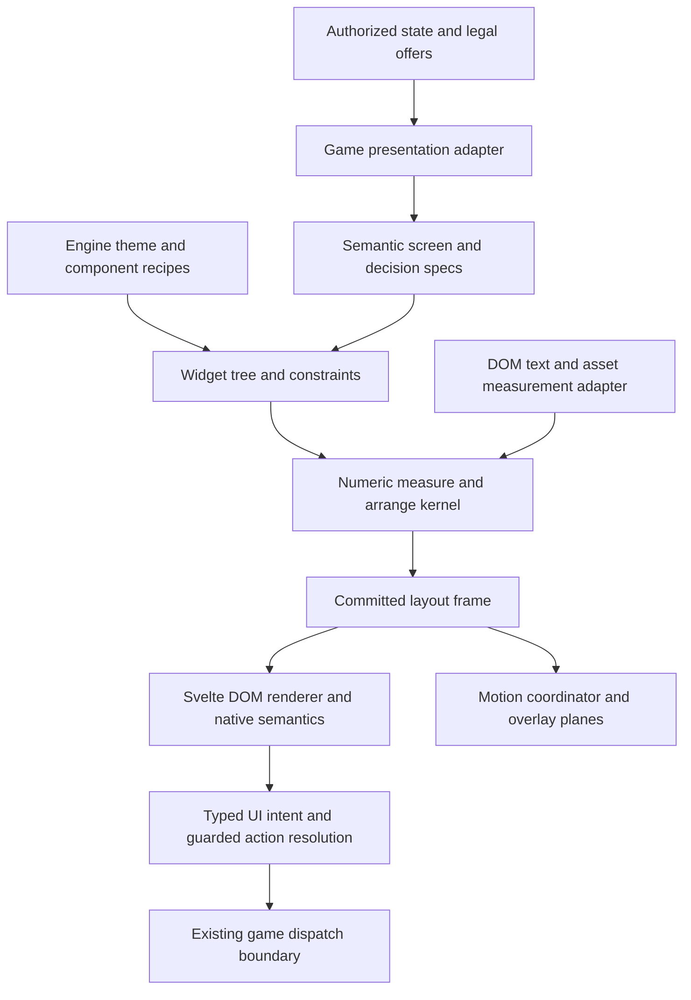

# Engine UI API research and design proposal

Replacement architecture: [Card game engine foundation](ENGINE_FOUNDATION.md) is the primary proposal for the engine's public semantic model, layout ownership and publication protocol. The survey and implementation history here remain background; the earlier structural/API direction is superseded where it differs.

Status: proposed design with the first production slice implemented, October 17, 2026. Mighty bidding uses the engine-owned decision controller and panel; broader APIs below remain proposals. See the implementation boundary in [Hardened engine API contracts](ENGINE_API_CONTRACTS.md).

The adversarial review produced [Hardened engine API contracts](ENGINE_API_CONTRACTS.md), the canonical revision for API shapes, controller ownership, privacy barriers, server context and layout lifecycle. The executable [contract spike](api-proposal/README.md) proves only its documented pure-contract subset.

Scope clarification: the product is a card-game engine. Read [Card game domain model and compatibility plan](CARD_GAME_ENGINE_MODEL.md) for the Mighty/poker/훌라/원카드 capability matrix, zones/groups/response windows, rule boundaries and backend gaps. This document specifies the reusable UI layer within that card-game engine, rather than proposing an unrelated general-purpose UI framework.

The source audit examined the dirty `codex/table-hierarchy` checkout at base commit `9cd1c04`. Four subagents covered retained UI systems, declarative UI systems, layout kernels, and our current consumers. Public documentation was inspected live; selected Godot and Bevy implementation sources were also inspected. No external engines were benchmarked. The deliverable is a design and migration plan, not a new engine-completion claim.

## Recommendation

Build an engine-owned semantic UI layer over the existing numeric geometry and DOM renderer. A game describes actions, choices, identities, cards, scores, and required relationships. Engine components own their size negotiation, spacing, adaptation, paint clearance, input behavior, and clipping.

Keep low-level layout primitives available to engine component authors. Ordinary game screens should not import them. Introduce a replaceable geometry-kernel boundary, but keep TypeScript for the first implementation. A different solver cannot supply missing component policy or remove browser font and DOM work.

Before freezing the domain APIs, use capability fixtures for Mighty, poker, 훌라 and 원카드. The first production UI slice remains Mighty bidding rendered through `DecisionPanel`, `ChoiceGroup`, and `ActionBar`, with no game-owned pixel layout. Other game rules and full gameplay remain separate implementation projects.

## What is wrong with the current boundary

The implementation mixes three responsibilities:

| Source evidence | Present responsibility | Intended owner |
| --- | --- | --- |
| `web/src/lib/table/DecisionRegion.svelte` exposes gap, inset, alignment, scrolling, and mode | Application chooses many layout details | Semantic widget recipes and engine theme |
| `decisionLayout.ts` has `bid`, `exchange`, and `discard` modes | Shared layout knows game phases | Generic component composition; game adapter supplies phase meaning |
| `DecisionRegion.svelte` recognizes classes such as `picks`, `contract-controls`, and `discard-btn` | CSS class names form an undocumented layout protocol | Typed child roles and stable IDs |
| `table/layout.ts` special-cases five seats with Mighty-specific footprint policy | Seat count stands in for content requirements | Explicit table topology and measured component requirements |
| Scroll insets and CSS animation amplitudes have separate constants | Layout cannot derive the actual effect envelope | One engine-owned motion/appearance recipe |

Existing foundations to preserve: `presentation.ts` typed offers and authorized projection; `CommandButton.svelte` gesture-generation guards; `commandBatch.ts` batch validation; `sceneCoordinates.ts` stable frame-local geometry; `sceneMotion.ts` resting-versus-visual pose handling; and the shared measurement scheduler.

Production scope matters: `scene.ts` calls its scene builder a preview helper, and production Mighty uses coordinate and motion primitives directly. Poker exists as `table/examples/poker.ts` plus `ContractDemo.svelte`; only Mighty is registered as a playable game. The poker fixture has two players, while current table seat counts are restricted to 3, 5, or 6. A shared-control demo does not establish a second playable game or a universal production scene graph.

## What other systems establish

These are documented/source findings. The proposed API choices in later sections are our synthesis, rather than claims that another engine already guarantees our desired behavior.

| System | Useful mechanism | Important limit | Consequence for this design |
| --- | --- | --- | --- |
| Godot | Containers own child placement; BoxContainer spacing comes from a theme constant | A default gap does not define a complete action-panel policy | Parent owns allocation; component recipes select theme spacing. [Containers](https://docs.godotengine.org/en/stable/tutorials/ui/gui_containers.html), [BoxContainer](https://docs.godotengine.org/en/stable/classes/class_boxcontainer.html) |
| Qt Quick | Layouts negotiate minimum, preferred, and maximum sizes and own child geometry | Nested spacing changes implicit sizes; application geometry overrides conflict with layout | Include spacing during measurement and forbid competing geometry ownership. [Layout overview](https://doc.qt.io/qt-6/qtquicklayouts-overview.html) |
| Flutter | Constraints descend, sizes return, parents place; OverflowBar can adapt row to column | OverflowBar spacing defaults to zero; adaptation does not infer a design system | Semantic ActionBar supplies defaults and fallback rules. [Constraints](https://docs.flutter.dev/ui/layout/constraints), [OverflowBar](https://api.flutter.dev/flutter/widgets/OverflowBar-class.html) |
| Jetpack Compose | Custom design systems can fix internal choices and expose selected parameters; composition, layout, and drawing have separate phases | Paint transforms do not reserve layout space; intrinsic measurement adds work | Restrict normal public knobs; distinguish measure, placement, and visual updates. [Design systems](https://developer.android.com/develop/ui/compose/designsystems/custom), [Phases](https://developer.android.com/develop/ui/compose/phases), [Graphics](https://developer.android.com/develop/ui/compose/graphics/draw/modifiers) |
| Bevy UI | Low-level layout, headless widgets, and themed Feathers are distinct layers | A flex/grid Node is not an opinionated button group | Separate policy/widgets from geometry and renderer. [Bevy 0.17](https://bevy.org/news/bevy-0-17/) |
| Yoga | Leaf measurement has explicit constraints; dirty propagation and changed-layout flags permit incremental work | Content measurement and rendering are external | Define a measured-leaf boundary and an incremental commit contract. [Measurement](https://www.yogalayout.dev/docs/advanced/external-layout-systems), [Incremental layout](https://www.yogalayout.dev/docs/advanced/incremental-layout) |
| Taffy | Provides flex/grid/block geometry and high- or low-level integration APIs | Caller supplies text measurement and surrounding UI behavior | A candidate internal solver, not the application API. [Architecture](https://docs.rs/taffy/latest/taffy/), [Scope and benchmark caveats](https://github.com/DioxusLabs/taffy) |

Godot's pinned 4.5 container implementation writes child rectangles and resets scale/rotation when fitting children. Layout and presentation transforms therefore need an explicit relationship. Our proposed wrapper separation is an inference from this and the other systems, not a recommendation to copy that reset behavior. [Container source](https://raw.githubusercontent.com/godotengine/godot/4.5-stable/scene/gui/container.cpp)

## Responsibility boundary

| Game adapter supplies | Engine owns |
| --- | --- |
| Authorized cards, legal action offers, labels, accessible descriptions, icons | Native control rendering, intrinsic requirements, wrapping and truncation rules |
| Meaningful choice groups, action order and intent, required versus optional information | Group spacing, alignment, minimum interactive dimensions, responsive variants |
| Player/seat association, public counters, table topology, game result data | Seat composition, local identity placement, hand fan layout, score columns, frame slots |
| Selection constraints and exact bindings to offered actions | Draft state, focus behavior, revision invalidation, guarded dispatch |
| Events and stable source/destination identities | Motion presets, presentation transforms, paint clearance, explicit clipping and overlay routing |

Server rules remain authoritative. The UI engine does not compute Mighty legality, poker betting rules, or private information from hidden game state. The adapter must project authorized information before it reaches layout, accessibility labels, diagnostics, or renderer caches.

Application code still declares composition and relationships. The engine cannot infer that two arbitrary labels form a radio group, that an action is destructive, or that a caption is required. Once those meanings are declared, it should supply the ordinary layout without per-game spacing code.

## Architecture



There is one parent allocator for each managed node. A child's allocated width is an output, not its next unconstrained preferred width. Stable node identity is independent of layout variant, translated label, and array index.

The DOM renderer remains valuable for text, native buttons/inputs, accessibility, and focus. Engine ownership means engine-owned recipes and placement decisions; it does not require eliminating CSS or rendering everything to canvas.

## Public API proposal

The first production surface exports an interaction controller, DecisionPanel, validated semantic descriptors and read-only outcomes, and an engine theme preset. ChoiceGroup and ActionBar initially remain internal widget recipes. The normal application API has no pixel gap, inset, scrolling or geometry props.

```svelte
<!-- Proposed usage; controller and model belong to the same projection. -->
<DecisionPanel decision={validatedDecision} controller={interactions} />
```

The host configures a narrow transport port on the engine controller once. Games do not implement guarded per-button submission callbacks. The controller owns draft transitions, gesture/binding/interaction generations, exact offered-action resolution and immutable submission envelopes. Server validation remains authoritative. The canonical contract distinguishes legacy action-only transport from future guarded command capabilities.

V1 descriptors discriminate commands-only from finite-choice decisions; unrelated properties are forbidden. The complete finite relation maps option tuples to exact existing command IDs. IDs, rather than labels or resulting values, preserve actions that look identical. The user-edited field is pinned before repairing other selections. There is no second dependency DAG in V1. Defaults, current eligibility and unavailable submission have distinct semantics; no command is promoted to primary automatically.

The gated numeric prototype binds one numeric action with an exact integer domain. Exceptional all-in remains a separate offered command. Combined card/choice/target/amount forms are a separately gated structured capability with one joint candidate binding, not a union of independently legal field values. See [canonical contracts](ENGINE_API_CONTRACTS.md#composite-interactions-and-amounts) and [executable fixtures](api-proposal/README.md).

Current numeric descriptors contain a createAction function, so the existing in-process contract is not a JSON/WASM protocol. Construction occurs only after validation at submission. The prototype uses independently shaped proposal types; integrating production ActionOffer requires an explicit validated adapter, not a cast.

Preserve current gesture, offer, disabled reason, draft A→B→A and focus-restoration behavior during migration. The controller owns raw editing/IME state as well as parsed values. Atomic structured actions and existing sequential command batches remain different mechanisms.

### Beyond decisions

Subsequent semantic components are `PlayerIdentity`, `Scoreboard`, `StatusPanel`, `ResultPanel`, `SelectionSummary`, `CardPicker`, and typed `TableScreen` slots. Score columns carry data kinds and importance so the engine can align numbers and adapt optional columns. Badges carry labels/assets and visual meaning; the shared API must not require Mighty-specific team enums for a poker dealer or all-in indicator.

Table topology is explicit and independent of game name. A table profile describes public seat associations and supported arrangements; component content requirements determine footprints. Two-player and six-player UI fixtures should work without turning `seatCount === 5` into an implicit style selector. This does not authorize silently changing the production table's existing supported seat counts.

## Internal contracts

```ts
interface Constraints {
  width: { min: number; max: number };
  height: { min: number; max: number };
}

type MeasureRequest =
  | { kind: 'intrinsic-width'; heightLimit?: number }
  | { kind: 'content'; width: { mode: 'exact' | 'at-most'; value: number }; heightLimit?: number };

interface ContentMeasurement {
  kind: 'content';
  size: Size;
  baseline?: number;
  paintOutsets: Insets;
  clearanceOutsets: Insets;
  hitPolicy: LocalHitPolicy;
}

type MeasureResult =
  | { kind: 'intrinsic-width'; minContentWidth: number; maxContentWidth: number }
  | ContentMeasurement;

interface WidgetDefinition<Props> {
  measure(props: Props, constraints: Constraints, env: MeasureEnvironment): Evaluation<ContentMeasurement>;
  arrange(props: Props, rect: Rect, env: ArrangeEnvironment): readonly Placement[];
}

interface LayoutFrame {
  epoch: number;
  candidate: CandidateToken;
  nodes: ReadonlyMap<NodeId, {
    layoutRect: Rect;
    contentRect: Rect;
    paintBounds: Rect;
    hitRegion: HitRegion;
    clipOwner: NodeId | null;
  }>;
  diagnostics: readonly LayoutDiagnostic[];
}
```

These are interface sketches. Widget measurement receives allocation constraints and obtains leaf measurements through MeasureEnvironment. Its leaf-request API uses the separate MeasureRequest/MeasureResult union: intrinsic requests return width hints, never a final allocation; content requests measure wrapping under an explicit exact or maximum width. Cache keys include request kind as well as constraints. A single preferred size cannot describe every wrapped label, and the kernel can skip a request when a recipe supplies definite dimensions. An uncached leaf request queues a batch read and marks the candidate frame pending; the engine does not fabricate a measurement or publish a partial frame. Evaluation explicitly returns ready, pending request IDs, or failed diagnostics. Candidate tokens bind projection, presentation, environment, draft and attempt; stale tagged replies cannot commit. The canonical contract defines terminal failures, bounded retention and retry conditions.

Leaf measurements, effect outsets, local hit policy, and baseline are node-local. Constraints are logical CSS-pixel dimensions. Final rectangles and hit geometry in LayoutFrame are frame-root-relative; local-to-frame transforms and clip-owner transforms are explicit. Final hit regions are produced after placement, rather than treating a local measurement hint as a screen-space region.

`paintOutsets` describe visible effects; `clearanceOutsets` describe the portion the recipe reserves against neighboring controls. They are deliberately different. A glow may overlap decoratively, while a focus ring needs clear space. A card fan declares intentional overlap and topmost-card input eligibility. Decorative paint expansion does not automatically expand the hit target.

Reserve clearance once at the parent allocation boundary. For independent adjacent controls, a recipe can require separation of at least `max(themeGap, trailingClearance + leadingClearance)`. A group whose internal padding already contains its children's clearance propagates only residual overflow outside its own allocation; enclosing wrappers must not charge the same inset again. Scroll extent includes reserved trailing space so the final item retains its paint envelope at the scroll limit.

Ordinary groups do not clip. ScrollViewport and Mask are explicit clip owners. A known motion preset declares its maximum paint envelope from the same theme data used by rendering. Reserve that envelope before the animation, without changing layout on each animation tick. Card flights and effects crossing regions use registered overlay planes with stable source/destination anchors and defined z-order.

Presentation transforms live beneath the allocation wrapper. Input policy is component-specific: a pressed button can retain its stable outer hit target, while a lifted card needs visual-pose-aware interaction. Rendering and interaction must interpret the same committed epoch and presentation transform policy.

## Theme and adaptation policy

One engine-owned theme defines control/group/section spacing, typography roles, minimum interaction dimensions, shadows, focus outlines and motion envelopes. Component recipes choose those tokens. Numeric metrics consumed by layout and their CSS rendering variables must be generated from the same values. Existing palette ownership should be preserved rather than duplicated during this change.

Use the current 8 px control grouping and 12 px section clearance as initial candidates to validate, not universal mathematical constants. A proposed 44 CSS px touch target is a product policy, not a claim that WCAG requires 44 everywhere. WCAG 2.2's minimum-target criterion has a 24 CSS px threshold and exceptions. [W3C target sizing](https://www.w3.org/WAI/WCAG22/Understanding/target-size-minimum)

Adapt using the allocated region, available height, text metrics, locale/direction, input mode and user settings. Widget policy chooses a fitting row, wrapped/stacked form, compact disclosure, or body viewport. Preserve semantic order. A DecisionPanel keeps its primary action reachable; lengthy choices belong in its body viewport or an engine-managed sheet, rather than clipping a partially visible confirmation button. If the minimum viable form cannot fit, report the constraint and choose a defined fallback rather than silently shrinking below minimums.

Row-to-stack adaptation should retain native control nodes when only placement changes. Compact disclosure has a different transition contract: preserve semantic IDs and draft, cancel an in-progress gesture, and move focus to the new disclosure trigger only if focus was inside the replaced group. Do not steal unrelated focus. Open its sheet only on user activation. If the window widens while that sheet is open, keep it until user dismissal; restore focus to the trigger, the corresponding inline option if the trigger disappeared, or a persistent panel fallback. Offer changes that remove the field close the obsolete sheet safely. Reparenting does not promise universal DOM-node identity preservation.

Native buttons and inputs remain the preferred DOM primitives. ChoiceGroup provides radio semantics and keyboard behavior, including the different interaction required when inside a toolbar; ActionBar is not automatically assigned `role=toolbar`. Labels and descriptions remain application-provided meaning. [W3C radio pattern](https://www.w3.org/WAI/ARIA/apg/patterns/radio/), [Toolbar pattern](https://www.w3.org/WAI/ARIA/apg/patterns/toolbar/)

## Measurement and frame publication

The target pipeline is semantic tree → constraints → cached leaf measurements → pure arrange → one committed frame → presentation updates.

Registered button/choice geometry is computed from recipes and measured content. DOM measurement is primarily for text, wrapping and registered custom assets, not the rendered size of every nested wrapper. Cache by content, font, theme, relevant constraints and locale revisions. State changes should invalidate the smallest affected dependency set; paint-only pulses, hover colors and progress fills must not trigger intrinsic measurement.

Natural-width measurement and height-at-allocated-width measurement are separate operations. Batch reads before writes. A bounded extra measurement pass can handle genuine text wrapping; the count should not grow merely because another wrapper was nested. Detect cycles and report the responsible nodes.

Publish displayed content/bindings, geometry, clipping and interaction data as one epoch. Retain an old frame only temporarily within its still-authorized projection scope. On observed viewer/access-scope change, revoke old private DOM/ARIA, overlays, hits, drafts and sensitive caches immediately, before asynchronous layout. Retained controls keep their exact old bindings: “Call 10” cannot become “Call 100” beneath unchanged pixels. Incompatible controls disable until matching content commits. Terminal failure uses a fitting accessible fallback and stops self-rescheduling; a new dependency revision or explicit retry starts another attempt. Current server validation remains mandatory. See the [canonical lifecycle](ENGINE_API_CONTRACTS.md#measurement-and-publication-lifecycle). The current 16-round scheduler is a migration bridge, not an unlimited atomicity or frame-time guarantee.

Record measurement time/count, geometry solve time, commit time, layout rounds and motion-only invalidations separately. Baseline the current build before the first slice. No constant-time or 16.7 ms guarantee follows from this research. Compare matched workloads and environments before adopting a new kernel.

## Enforcing engine ownership

| Boundary | Enforcement |
| --- | --- |
| Public API | Export semantic props; keep numeric layout and renderer node types internal |
| Game source | Extend existing AST/import policy tests to reject direct low-level layout imports and ordinary managed-node geometry/overflow overrides |
| Runtime diagnostics | Report constraint violations, unintended hit overlap, clipped declared effects, multiple geometry owners, and measurement cycles with node IDs |
| Theme consistency | Test the shared origin of render metrics and layout metrics; no separately handwritten animation amplitudes and safety insets |
| Custom content | Explicit registered widget/scene extension with measurement, effects, semantics, hit policy and tests; no invisible bypass through arbitrary snippets |

AbsoluteScene is a legitimate internal primitive for cards and table arrangements. It is not the default route for buttons. Custom widgets may use low-level primitives inside their registered engine implementation. New game-specific styles must not reach into managed descendants to change their geometry. Build checks and diagnostics can enforce the supported authored surface; they cannot make arbitrary injected/global CSS safe.

## Migration plan and acceptance gates

| Slice | Work and deletions | Required evidence before advancing |
| --- | --- | --- |
| 1. Contracts and baseline | Introduce internal theme/measurement/bounds contracts and public module boundary; record current visual, action and performance behavior; define the four-family card-domain fixtures before API freeze | Independent fixtures for spacing, paint/hit separation and measurement invalidation; existing stale-offer/privacy tests preserved; domain model can express groups, stock, targets, amounts and response windows |
| 2. Bidding proof | Implement DecisionPanel, ChoiceGroup and ActionBar; migrate only Mighty bidding; remove shared `bid` mode and CSS-class protocol for that path | Exact offered-action equivalence; three-action case; no raw game gap/inset/scroll; Korean/long labels; normal/reduced/off motion; focus/pulse/entrance and both scroll ends; continuous resize |
| 3. Other decisions | Migrate exchange, discard batches, friend/card picker and numeric actions; remove `exchange`/`discard` layout branches and related class detection | Existing confirmation, batch count/membership, Joker variants, delayed input, revision and focus-restoration tests; body scrolling does not hide primary submission |
| 4. Playing-screen composition | Add typed table slots and semantic identities/status/score/result widgets; replace selector discovery and duplicate height plumbing; preserve intentional card overlap | Real room → bot setup → full hand → result → next hand; observer and five-human handoff; stable seat and selected-card stacking behavior; same-page resize and interrupted motion |
| 5. Generality and performance | Exercise poker, 훌라 and 원카드 capability fixtures through the same card-table and semantic UI APIs; retire compatibility paths; benchmark solver boundary | No Mighty names in shared policy and no ordinary low-level game imports; common controls require no per-game pixel overrides; inspect Chrome and Safari; apply the domain companion's server/window/action-validation gates; compare whole-pipeline timings before any Taffy/WASM experiment |

Baseline physical viewports: 320×568, 390×844, 568×320, 768×1024, 1024×768 and 1440×900. Include dark/light, large text and delayed font loading, long Korean/Latin labels, rapid offer changes, keyboard and pointer input, and resizes during animations. These are planned gates, not tests executed for this research task.

The second-game fixture gate proves UI reuse only. Poker server rules, authoritative betting, complete lifecycle and deployment need their own implementation and acceptance.

## Decisions deliberately deferred

Adopting Yoga/Taffy, moving geometry to WASM, a canvas renderer rewrite, and a serialized public UI protocol are separate decisions. First measure whether geometry computation dominates after wrapper measurement and ownership are corrected. A kernel experiment must use the same semantic API and measurement inputs so it cannot conceal a different workload.

This proposal also does not promise zero overlap or zero clipping everywhere: card fans, badges, scrollers and masks have legitimate overlap/clip contracts. It proposes that those contracts be explicit and owned by the engine, with accidental violations detectable.

## Research coverage and limitations

Qt pages were labeled 6.12.0 when inspected. Godot documentation used the moving stable channel, with container source pinned separately to 4.5-stable. Flutter documentation and generated API pages have inconsistent version footers; no release identity is inferred from a `0.0.0` footer. Compose's specific LayerOutsets API is alpha-only in the inspected graphics guide; the proposal borrows the bounds distinction, not that dependency. Bevy's 0.17 release article and current Taffy/Yoga documentation establish layer boundaries, not comparative performance.

This is a bounded survey of seven relevant systems, not an exhaustive engine review. No external runtime comparisons were run, and no new performance claim is made. DevRelay community tools were not exposed in this session; no community consensus is claimed. The evidence is official documentation, selected official source, and the current repository audit.
